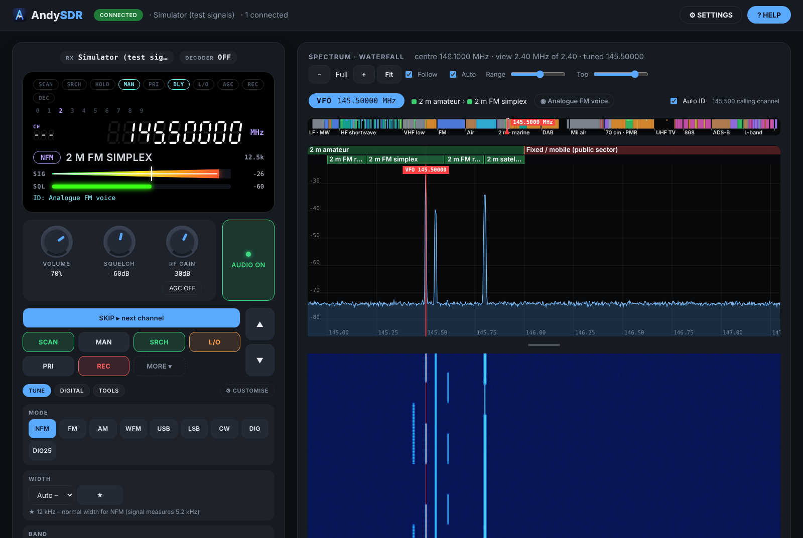
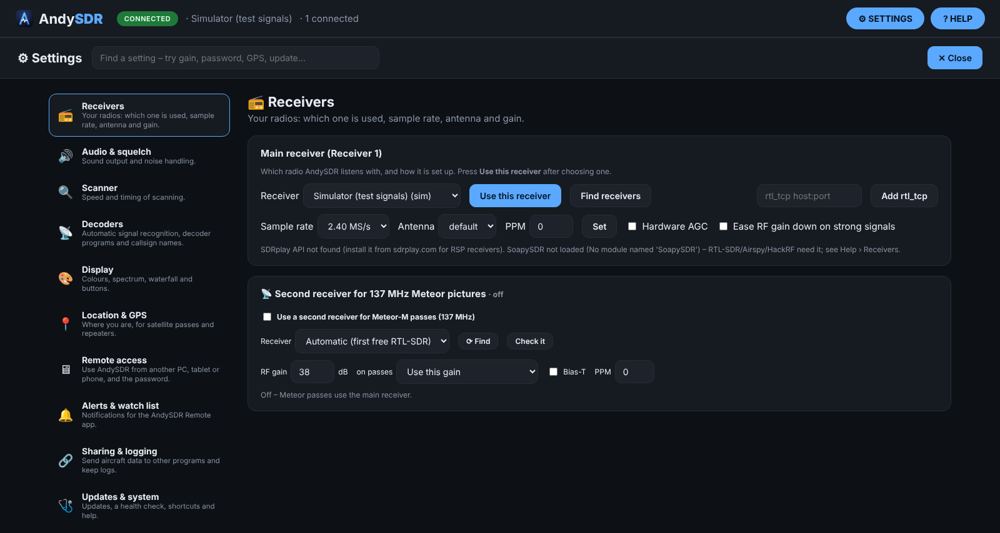
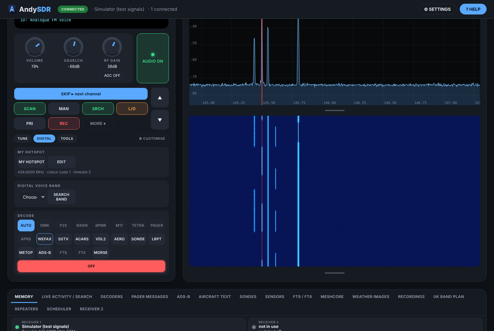
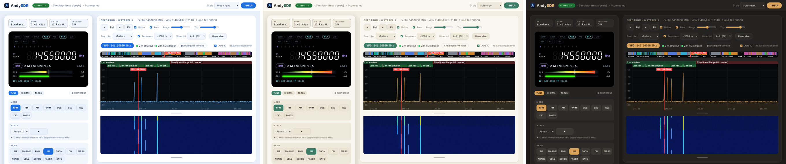
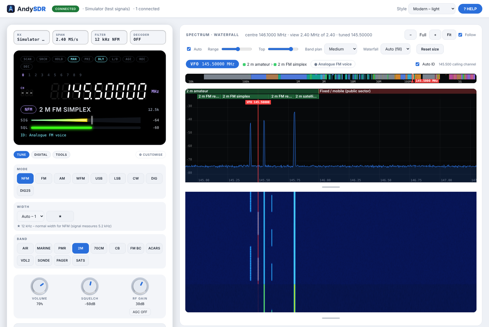
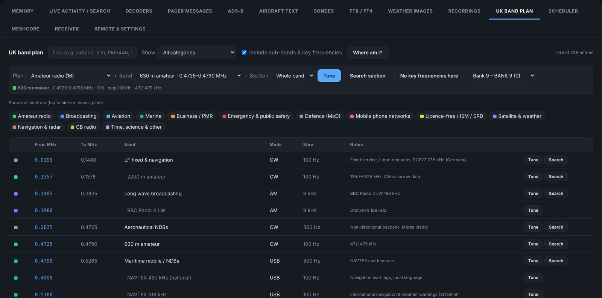

# AndySDR

A desktop SDR scanner for Windows 10/11 with a classic hardware-scanner front panel, a live
spectrum/waterfall, 1000 memory channels, a band search that finds every live transmission,
RadioReference UK CSV import, digital/analogue decoding, weather pictures, and a built-in
network server so any other PC, laptop, tablet or phone in the house can use the radio.

**Latest: 1.31.2** – **the Northwood WEFAX memory channel is on the carrier, not the published figure.** It was stored at 8040.000 kHz, 1.9 kHz above where the chart is actually sent, so the fax tones fell outside the decoder and no chart could be decoded. It now sits at **8038.100 kHz USB**. A saved copy of that channel is corrected automatically the first time 1.31.2 starts; any channel you renamed or retuned yourself is left alone.

**Before that: 1.31.1** – **every pass now checks whether the receiver is really on frequency, and says which kind of error it is.** A satellite pass is the one time a receiver is handed a signal whose true frequency is known in advance: the orbit says where the carrier will be, second by second. Any difference is error, and measuring it right through a pass says *which* error – which one reading never can. **A constant offset is the receiver's own crystal**, the same proportion at every frequency, and a ppm correction cures it; AndySDR works out the figure and tells you what to set. **An offset that swings with the satellite's speed** is the orbit prediction, usually orbit data that wants refreshing, and a ppm correction would make every other band worse. **An offset that creeps one way through the pass** is the crystal warming up. At 137.9 MHz one part per million is 138 Hz, and the same error is 11 kHz at 1090 MHz, which is why an oscillator a few ppm out shows itself on ADS-B long before anywhere else. The measurement does not hunt for a peak – an LRPT carrier is 120 kHz wide and flat on top, so its peak wanders with the noise; it slides a block the width of the signal across the spectrum, takes the fullest position and then finds the middle of the power inside it, which reads finer than one bin. Both receivers are checked independently, and nothing is concluded from a weak pass: scattered readings are reported as scattered rather than turned into a correction.

**Before that: 1.31.0** – **three faults found by using it rather than reading it.** *The RECEIVER 2 panel still would not appear* – because the fix before last mended the wide layout and left the narrow one alone, so on a window under 1100px the panel was auto-placed into a row of its own several thousand pixels below the page. A layout test now reads the stylesheet and checks that **every** `.wrap` layout has a square for every panel, because this cannot be seen in one browser at one window size, which is exactly how it survived two attempts. *Auto ID flip-flopped between AM and FM* about once a second on ACARS and switched the demodulator each time – demodulating AM as FM, which sounds like bad distortion. ACARS is silence most of the time and the classifier was reading the gaps, where noise is as likely to look like FM as AM. Only readings taken while there is a signal now get a vote, a run of four is needed, there is a quiet period after each change, and if it still changes its mind repeatedly on one frequency it stops and says so. *TETRA was announced on anything over 15 kHz wide* – which is most of a 12.5 kHz channel measured generously, so ordinary business radio on 165, 168, 454 and 469 MHz was being called TETRA and a decoder started that could never produce anything. Measured on those real signals the false ones ran 15.1 to 18.6 kHz; real TETRA on 380.7875 MHz measured 20.7. The bar is raised to where a 12.5 kHz system cannot reach, the envelope has a ceiling as well as a floor, and outside the bands TETRA is actually allocated in it is described as what it is – a wideband digital carrier – with no decoder started. On the emergency-services band it now says plainly that the air interface is encrypted and neither speech nor data will decode, which saves an evening.

**Before that: 1.30.2** – **the automatic gain no longer takes range off a decoder that needs the gain left alone.** “Ease RF gain down on strong signals” had no idea a decoder was running. Two things were wrong with that. ADS-B has no gain of its own – it uses whatever the main radio is set to – so every step the automatic gain took came straight off its range, and the narrowband channel level it was reading at 1090 MHz told it nothing useful in the first place. And the step size was written as a fraction of the receiver's gain range: on a dongle that is a gentle 3 dB and a 25 dB limit, but the SDRplay's range is 0–100, so the same fractions gave **6 dB jumps and a 50 dB drop** – not easing anything, just going deaf. It now stays out of the way entirely for anything handed raw IQ (ADS-B, MeshCore, the sensor bands, AERO, the satellites) and for anything where the amplitude *is* the information (ACARS is AM; a WEFAX or SSTV picture is drawn by amplitude, so moving the gain part way through puts a band across it). Steps are capped at 3 dB and the total drop at 20 dB whatever the receiver's range. What is left is what it was written for – FM voice, pagers, packet – where only the frequency carries meaning and backing off a distorting signal genuinely helps.

**Before that: 1.30.1** – **a timed capture that duplicates a tracked satellite now says so, and offers to switch itself off.** The schedule already warned when two captures overlapped. What it could not say is that two of them were the same job. A daily capture on 137.900 MHz from 03:46 for twenty-five minutes held the radio until 04:11, so the Meteor-M N2-4 pass that began at 04:05 was recorded from 04:11 to 04:15 – four minutes of ten. That is not an ordinary clash: the timer cannot follow the satellite, it records the quiet minutes either side whether or not anything is overhead, and because it starts first it takes the pass away from the tracking that would have done it properly. AndySDR now recognises a timed capture aimed at the same frequency and the same job as a satellite it already tracks, says plainly that switching it off loses nothing, and puts the button next to the sentence. It says it when the capture is created, too, which is the cheapest moment to think again.

**Before that: 1.30.0** – **AndySDR can follow a trunked system.** On a trunked network the talking is not on the frequency you are listening to: one channel carries nothing but signalling, and when somebody presses the key it says, in effect, *“this call is on channel 17 for the next half minute”*. Sit on the control channel and you hear data; sit on a voice channel and you catch one call in ten. Following a conversation means moving to each call's channel and back within a fraction of a second. DSD-FME already knows how to read those grants – what it needs is something that will retune when it asks, over the **rigctl** protocol that SDR++ and Hamlib radios speak. AndySDR now is that something. Leave the radio on the control channel, pick one of the new **Trunked** sub-modes (DMR Tier III / Capacity+ / Connect+, P25, P25 Phase 2, NXDN) and each call is followed and dropped automatically. **Where the call lands inside the slice the receiver is already capturing, nothing is retuned at all** – the radio just listens to a different part of what it already has, so there is no delay and no clipped start of a call. That is where a wide receiver earns its keep: an RSP2 at 7.2 MS/s can hold a whole site at once. Most DMR systems need a channel map, because the control channel talks in channel numbers rather than frequencies, so there is a box to paste one into (451200000 and 451.2 both work) along with an optional talkgroup-name list; P25 systems usually need neither, because they broadcast their frequencies. The panel shows how many calls have been followed and where the last one was, which is the quickest way to tell whether a map is right. The tuning server listens to this machine only and runs only while a trunked sub-mode is selected, because anything that can reach it could retune the radio.

**Before that: 1.29.0** – **every pass now measures what signal it actually took to decode.** The report used to give the peak and the typical signal, neither of which answers the question that decides whether a pass is worth recording. Every Meteor frame carries a number that counts up whether or not you hear it, so AndySDR can now say how many of the frames the satellite sent while it was in reach actually arrived – 55% means four frames in ten were missed – and that is exact, resting on nothing. Those same numbers are a clock, so the run of frames can be laid over the signal trace from the same pass, and the new **Frames** column also shows the weakest signal that was still producing them: *“55% · to 2.7 dB”*. That is the real threshold for this receiver and this aerial, measured on the day rather than guessed at from whether pictures came out, and it is the number to watch when an aerial, a filter or a lead changes. It is left blank when too few frames arrived to place them in time, or when they arrived too steadily to tell one moment from another – no figure is better than an invented one. The `.cadu` files of every pass already recorded are read once at startup too, so the coverage figures for the existing archive appear straight away; the threshold only starts from passes recorded from here on, because the signal traces of the older ones were never kept.

**Before that: 1.28.2** – **the gain test now says how much gain is too much, and gives up instead of hanging.** Its sweep already measured the whole curve, but it only looked for the lower bend – the point where you start hearing the aerial rather than the receiver. There is usually a second bend near the top, where the noise floor stops following the gain again: that one is the front end beginning to compress, and it is common behind a mast preamplifier. The test now finds it and reports it – *“do not go above 39 dB on this aerial”* – never recommends a gain above it, and counts headroom up to it rather than to the top of the dial – or up to the overload point, whichever comes first, since a receiver that has told you it is overloading has 0 dB left in hand, not 67. Readings taken above that overload point are ignored when looking for the ceiling: a real RSP2 sweep has the floor dropping 40 dB there and then leaping back, and none of that is a measurement. On the 137 MHz dongle the measured bend is 38.6 dB, which is why 40 dB was a poor setting there. Two other fixes: if the receiver stops sending samples part way through a sweep – another copy of the program has it open, or a lead is knocked – the test now gives up after eight seconds, puts the gain back and says so on screen, instead of sitting at “step 1 of 22” with the radio deaf; and the **RECEIVER 2 panel now actually appears**, having been placed off the bottom of the page by the screen layout rather than between the spectrum and the tabs where it belongs.

**Before that: 1.28.0** – **both receivers are now on screen at once, each named**. The second receiver used to live inside the satellite page, so the main screen looked like a one-radio program – and the figure beside the receiver's name in the header, “1 connected”, read as though only one of the two was working when it was really counting screens. Now: the header names both radios (“SDRplay RSP2 (180800E611) + Nooelec NESDR SMArt v5”), the spectrum is labelled **RECEIVER 1** with its hardware name, and a permanent **RECEIVER 2** panel sits underneath with its own name, a coloured state dot (grey off, green awake, blue live view, red recording), the pass it is waiting for, live signal, gain and elevation, and its own trace and waterfall. The screen count only appears when somebody else really is connected, and then says so in words – “also open on 1 other screen”.

**Before that: 1.27.3** – **the gain test no longer drops the gain to nothing when there is a preamplifier in front**. Its rule was “use the lowest gain at which the noise floor follows the gain”, which is right when that bend sits somewhere in the receiver's range. On the 137 MHz dongle, which has a powered LNA ahead of it, the floor follows the gain from the very first step: the aerial is already louder than the dongle everywhere, so the bend is below the range entirely. The test read that correctly and then drew the wrong conclusion, setting the gain to 0 dB. It now recognises that case, keeps the gain where it was, and says so – that nothing in the sweep makes one setting better than another for sensitivity, and that overload at the top end is what is worth watching at that aerial instead. The readings are also written to the log now, so a surprising answer can be checked rather than guessed at.

**Before that: 1.27.2** – **the gain test now moves the squelch with it, and the second receiver has one of its own**. Squelch is a level in dBFS, so it only means anything against a particular gain: the first real run of the gain test on a Marine VHF aerial took the gain from 60 dB down to 28.6 dB, which dropped every signal 31 dB and left a squelch nothing could open – the scanner went deaf. The test now shifts the squelch by exactly the amount it shifts the gain, so the same signals go on opening it, and says so in the result. Putting the gain back, or picking a saved one from the list, carries the squelch the same way. A squelch left wide open is left wide open. **Receiver 2 now has its own Find the best gain**, on its own screen: it opens the dongle on 137.900 MHz, sweeps its 29 gain steps and measures the bend, which settles what the right gain for the Meteor aerial actually is instead of judging it off the waterfall. It will not run during a pass.

**Before that: 1.27.1** – **two small things that have each cost an evening**. The *“use both receivers” tick no longer looks as though it changes itself*: there are two of them, the one on the Receiver 2 screen and a per-satellite one in each Meteor's Options on the Scheduler, and the per-satellite one wins whenever it has been touched. When the two disagree the Receiver 2 screen now says which satellites have their own answer, instead of quietly showing a setting nobody is using. And the *Pass report now says how many pictures are worth keeping*, not just the median fill: a pass that shows “76%” can be one good picture and one of static, which “1/2 good” beside it makes plain. Up to 24 pictures a pass are measured now rather than 12.

**Before that: 1.27.0** – **AndySDR can now find the best RF gain for itself, band by band**. There is no single right gain: it depends on the aerial, the band and what else is on the air, which is why a number chosen once and left alone is usually wrong. Settings › Receivers has a **Find the best gain** button. It turns the gain up step by step and watches the noise floor: while the receiver's own noise is the louder of the two the floor barely moves, and once the aerial's noise is the louder it follows the gain one dB for one dB. The bend between them is the answer, and the gain chosen is just above it – the point where you are hearing the aerial and not the receiver, with under half a decibel lost to the receiver. More gain than that improves nothing and only loses headroom. The sweep takes about 15 seconds, uses the receiver's own gain steps where it has them, and refuses to run during a scheduled capture or while scanning. If the receiver reports being overloaded part way up, it stops below that and says so; if the noise floor barely moves at all it says the aerial may be very quiet or not connected rather than quietly picking a number. Every answer is kept against the band and the receiver it was measured on, with a list to put any of them back in one press. 'Ease RF gain down on strong signals' still works on top: this sets the ceiling, that one backs off from it.

**Before that: 1.26.9** – **aircraft messages are now read, not just shown**. An ACARS body is one long run-on line of an airline's own making, and a lot of it is machine data that will never be readable – but a good share of it carries a position, where the flight is going and the navigation points it is passing, and all of that was being thrown away. AndySDR now reads the body and labels what it finds: latitude and longitude in the five layouts that are actually heard, the airports the flight is between, the navigation points with the times against them, and what the message is for (an engine-data download, a datalink logon, an oceanic clearance, a position contract). Each message row shows what was read as small chips under the text, the detail window lays the body out line by line, and the search box looks in the decoded parts too. Measured against a real day's reception (729 messages on 27 Nov, 477 of them with any text): 416 now carry something labelled – 20 positions, 68 routes, 62 sets of navigation points and 380 named applications. Positions are checked against the receiver's own location, so a misread cannot put an aircraft on the other side of the world. Also: the figure at the top of the screen now says “1 screen” rather than “1 connected”, which read as though only one of the two receivers was working.

**Before that: 1.26.8** – **three accuracy fixes found in a review of the decoding and measuring code**. *Signal (dB) was flattering every weak pass*: the channel holds the signal **and** the noise, and the noise was never taken off before the two were compared, so a channel with nothing in it still read about +2 dB and a true 0 dB read +3.4 dB. The error was worst exactly where it matters. The noise is now subtracted first: an empty channel reads about −11 dB, and the figures are within about 0.5 dB of the truth from −3 dB upwards. Figures already in the pass report keep their old values, so passes from before and after are not directly comparable. The same routine used to give no reading at all when the channel was wide compared with the view (a 120 kHz LRPT channel in a 240 kHz view left no room for its guard bands); it now narrows the guard instead of giving up. *A steady tone on FM was read as a pager*: a sine wave's discriminator is flatter-topped than speech, which is the test used to spot 2FSK, so a test tone, a pip, a paging alert or mains hum could be announced as “Pager – POCSAG 2400” and switch the mode. Auto ID now measures how much of the discriminator's power sits in one or two narrow lines (a tone 0.99, real data 0.01–0.17, speech 0.02) and will not call a pure tone a digital system. A second fault in the same place let the pager test run even when the “is this really digital?” check had already failed. The Auto ID benchmark gains 36 new tone readings and still identifies all 60 real-signal cells. *Update checks stopped making a doomed connection first*: on a PC whose own certificate store cannot verify GitHub, every check and every download failed once and then retried with the bundled list; the bundled list is now used for the rest of the session after the first failure.

**Before that: 1.26.7** – **AndySDR can start itself when you sign in to Windows**: a scheduled satellite pass is only recorded while the program is running, so a restart in the night (a Windows update, a power cut) quietly costs a morning's pictures – which is what happened to the 19:36 pass on 27 Nov. Settings now has a tick, “Start AndySDR when I sign in to Windows”, which adds AndySDR to the per-user sign-in start list. No administrator rights, nothing installed, and unticking it takes the entry away again. If an update or a move leaves the entry pointing at a path that is no longer there, start-up quietly puts the right one back. The tick only appears in the installed AndySDR (run from source there is no single command for Windows to start), and a PC left at the lock screen with nobody signed in still will not start it.

**Before that: 1.26.6** – **the picture “Fill” figure no longer counts static as picture**: Fill was the share of scan lines that were not pure black, so a receiver that lost the signal and filled its lines with random speckle still scored high – a pass showing a mostly-static picture was reported as 80.6%. Lines are now also checked for being smooth along the row (a real scan line looks like its neighbouring pixels, static does not), and static lines count as missed. The same real picture now reads 30.2%, and a clean one 76.3%.

**Before that: 1.26.5** – **the “use both receivers” merge now says what happened, and leaves no empty folders**: when a pass was recorded on both receivers, the merge only checked that each one had produced a frames file – not that there was anything in it. A receiver that hears nothing still writes an empty file, so the check passed, a `_merged` folder was created, and the merge then found it had only one usable receiver, gave up and left the folder empty with nothing in it to say why. Every merged folder made so far was one of these. The frames are now counted first: no folder is created unless two receivers each heard at least one frame, and the pass log names the receiver that heard nothing instead of reporting a failure. The wait for the slower receiver also starts when the first one finishes rather than when the pass began, so a long pass followed by a slow SatDump run can no longer use up the whole wait before either receiver has reported and throw away a pass that could have been merged. Checked against a real pass (254 frames on one receiver, none on the other) and by splitting those same 254 real frames across two receivers fading at different times – 170 and 134 frames, merged back to the full 254, 49% more than the better receiver alone. Changes to the second receiver's settings are now written to the log with the old value, the new value and who asked, so a setting that turns up holding a value nobody remembers choosing can be traced.

**1.26.4** – **MUTE / AUDIO now work reliably**: there were two separate mute switches – the big AUDIO key and the MUTE quick button – that did not know about each other. Muting with the quick button and then pressing the AUDIO key closed the sound and reopened it, but the mute was still set, so the key read MUTED and stayed silent however often it was pressed. They are now one switch: the first press starts the audio, after that it mutes and un-mutes at once (the audio is kept running, not closed and rebuilt), the radio stops sending sound to a muted screen, and the key and the quick button always show the same state. Checked in a real browser by measuring the sound at the output after each press, in every mix of the key and the quick button (the old version fails that test).

**1.26.3** – **no more jumping panels**: the green Auto-ID chip ("◉ DMR voice → decoding") used to appear and disappear as the signal came and went, and each time the rows around it grew and shrank - the Decoders log and the bar above the spectrum jumped up and down. The chip now keeps its place (hidden or shown, the row is the same height), a signal that drops out for a moment keeps its label for 5 seconds instead of flickering (it still clears at once when you retune), long names are cut with "…" rather than wrapping onto a second line, and the decoder log adds each new line instead of rebuilding the whole log every time. Checked in the real page: bar and log heights identical with no signal, a named signal and a very long name.

**1.26.2** – **the frequency no longer wanders**: the radio's keyboard shortcuts (▲▼ step the frequency, 0-9 . Enter, S M P L N) used to work anywhere on the page, so scrolling a long tab with the arrow keys moved the tuning by one step (12.5 kHz: 168.0000 ↔ 167.9875 MHz), and a stray S, M or P could start a scan or store a channel. They now work only while the mouse pointer is over the radio or the spectrum; anywhere else the keys do their normal job (▲▼ scroll, Space/Enter press the focused button), and Ctrl/Alt/⌘ combinations are never taken. Checked with the real page: arrow keys away from the radio left the frequency alone and scrolled the page, over the radio they still step. Every tune/step request is now written to the log with the address it came from, so an unexpected change can be traced.

**1.26.1** – **bug-check release**: a single NaN / infinite signal reading (a dropped buffer) can no longer corrupt a message to the browser – it used to make the pass report or antenna map message unreadable; such readings are no longer recorded as pass measurements; garbage samples are no longer shown as "Analogue FM voice". Checked by running the real server against the built-in signal generator and clicking through every tab, button, scheduler panel and setting (no page errors), sending 111 commands with missing / wrong-typed fields (server and connections survived), and testing the file routes for path traversal and password protection (all safe).

**1.26.0** – **more accurate Auto ID**: it now tells **FM, AM and upper/lower sideband** voice apart from the signal itself (not from whichever mode is selected) and switches the demodulator to **NFM / AM / USB / LSB** by itself, after two consistent readings. A mode you pick by hand is respected until you tune elsewhere, and a carrier with nobody talking is left alone. Fixed: speech occasionally read as a digital signal (about 4 % of readings in tests – now none), weak NXDN/dPMR read as a pager, **DTMF** never recognised, and analogue FM left in a digital (DIG) mode like the 168 MHz case. Checked with a new benchmark of synthetic signals (`tests/test_autoid_bench.py`, 20 signal types at several strengths).

**1.25.3** – **tidier quick buttons**: the BAND buttons are split into *Everyday* and *Data & satellites*, and the 21 DECODE buttons into *Voice*, *Data & messages* and *Pictures*. Same buttons, same places in the TUNE / DIGITAL / TOOLS pages – just easier to find.

**1.25.2** – **tidier Scheduler**: three panels behind a small switch – **Satellite passes** (switch satellites on, pass times, the L-band pointing helper), **Pass report** (how each pass went, the Fill score, set-aside option and the antenna map) and **Timed captures** (weather fax, SSTV and other timed recordings). It opens on the one you used last.

**1.25.1** – **tidier main screen**: the row of 15 tabs is now four headings – **LISTEN** (memory, live activity, decoders, band plan, repeaters), **DATA & MESSAGES** (pagers, ADS-B, aircraft text, sondes, sensors, FT8, MeshCore), **SATELLITES** (scheduler, receiver 2) and **PICTURES & AUDIO** – and only the tabs of the open heading show. A dot on a heading means something new arrived inside it. The tablet/phone menu is unchanged.

**1.25.0** – **tools for getting better satellite pictures**, all on the pass report: a **Fill** column (how much of the picture is filled in – scan lines with data between the first and the last – shown for each receiver and after merging both); a small **✎ note** on every pass (e.g. "antenna turned 20° east"); an **Antenna map** (SCHEDULER, under the pass report: a sky plot of where your signal is strong or weak, with a one-line verdict such as "weakest toward NW"); an optional **Set aside pictures under N % filled** (they go to a separate `images_poor` folder, never deleted); and an optional **"pass finished" alert** for the phone/tablet app (how many pictures and how filled-in, also after a dual-receiver merge). Passes recorded from now on carry the sky track the antenna map needs.

**1.24.4** – **choose dual or single receiving for each satellite**: on **SCHEDULER › Satellite auto-capture**, each Meteor-M row now has a **Both receivers** tick box (shown while the second receiver is switched on). Ticked, the main radio and the second receiver both record every pass of that satellite and the pictures are merged afterwards; unticked, the second receiver records it alone. Until you choose, a satellite follows the setting on the Receiver 2 screen, as before.

**1.24.3** – **longer live view and an aiming tone** on the second receiver screen: *Watch live* is no longer limited to 90 seconds – pick 90 s, 5 min, 15 min, 1 hour or *Until I stop it* – the signal number is now large enough to read from across the roof, and a **🔊 Tone** box plays a note that rises as the signal gets stronger so you can turn the antenna without looking. A real pass still takes over, and a view left on is ended after 4 hours.

**1.24.2** – fixes *Use both receivers for a pass*: both receivers named their recording after the time the pass started, so when they shared a pass they wrote into the same file and spoiled each other's recording. Each receiver now records to its own file, and a merge is refused if the two ever point at the same folder.

**1.24.1** – fixes the *Use both receivers for a pass* tickbox, which in 1.24.0 looked ticked but never reached the program.

**1.24.0** – **Use both receivers for a pass.** Meteor's signal spins as it travels, and a straight antenna (a V-dipole, a discone, a whip) loses it for a moment each time the spin turns away, which is what leaves the black bands across a picture. Two aerials pointing different ways rarely lose it at the same moment. Tick *Use both receivers for a pass* on the RECEIVER 2 tab and the main radio records the Meteor pass as well; afterwards the frames each receiver heard are put together into one fuller set of pictures, on top of the pictures each receiver makes on its own. The main radio stops scanning while the satellite is overhead, and a pass uses about twice the disk space until the pictures are made.

**1.23.1** – **AndySDR now starts with your normal rights after an update**: the installer used to start AndySDR again with its own administrator rights, which stops other normal programs (remote-control tools, helpers) from clicking or typing in the AndySDR window. The Setup program still needs permission to write to *Program Files*, but AndySDR itself is launched as you. If your copy is running as administrator, close it and start it from the desktop shortcut once. The RECEIVER 2 RF-gain tip no longer claims a fixed 35-45 dB range - the best value depends on your antenna and dongle.

**1.23.0** – **a tidier look and one Settings page**: every setting now lives on a single **⚙ SETTINGS** page (top bar), in labelled groups – Receivers, Sound, Scanner, Decoders, Display, Location & GPS, Remote access, Alerts, Sharing & logging, Updates & system – with a **search box** (type *gain*, *password*, *GPS*...) and a left-hand list to jump between groups; the RECEIVER 1 and REMOTE & SETTINGS tabs are gone, and the places that used to say "go to the Receiver tab" now open the right group directly. The radio screen is calmer: one scroll instead of several, the keypad shows the seven keys you use with a **MORE** button for the rest, and the Style and Layout menus moved into Settings › Display. **Buttons now share a colour code**: red = recording or stop (REC, decoder OFF), orange = lock out or ignore (L/O, LOCK OUT, SKIP 10 MIN, UNSKIP), green = scanning or searching (SCAN, SRCH); tinted means ready, solid means on, and REC pulses while it records. The audio key now reads **AUDIO ON** (green) or **MUTED** with a slow red glow when there is no sound. **Second receiver (Nooelec) fix – an unbroken sample stream**: the dongle was being read in short bursts with the processing in between, so about 5 % of the samples were thrown away in tiny gaps every 50 ms. That does not show on the spectrum but stops SatDump finding a single Meteor frame (every pass had shown a good signal and made no picture). The dongle now streams continuously in the background; each pass logs *Second receiver stream: N s of samples in M s* so the result can be checked (about 100 % is right), and the **CHECK MY SYSTEM zip now includes SatDump's own log** for the last three passes. The Android app's "under Settings" wording changed too (needs the next APK build). **1.22.6** – **Inmarsat AERO decoder** (aircraft messages relayed by the 1545 MHz satellite): press AERO in the DECODE row or ▶ Start AERO in the Aircraft Text tab. AndySDR feeds SatDump's Inmarsat decoder the receiver's IQ (channel shifted to DC, 240 kS/s) and lists the ACARS messages it reads in AIRCRAFT TEXT, marked AERO with the aircraft's ICAO address. Rates 1200, 600 and 10500 bit/s, or AUTO, which tries each in turn until the decoder locks. A lock light and status line show lock, bit-error rate and SNR, and ⌖ Centre on carrier measures where the carrier really is and moves the tuning onto it, to within a few Hz. Needs an L-band patch/helix with an LNA on bias-T (RSP2: Antenna B). Voice (AERO-C) is deliberately not decoded. Tested here against a fake SatDump and synthetic carriers; real-signal tuning waits for an L-band antenna. Also fixes the second receiver skipping a satellite pass after its live view had been open (the dongle's serial vanished from the scan while it was in use), and **Auto-identify now recognises a DMR repeater that it used to call a pager or FM voice** (found by replaying a real recording: DMR's frame structure leaves a weak 1200 Hz line that was mistaken for a 1200 Bd pager), and **no longer swaps decoders back and forth on a signal it cannot name**: when its guesses keep changing (P25 / DMR, FM voice, NXDN, pager ...) with no clear winner it now says *Unidentified signal – try a decoder by hand* (or *Digital voice – decoder locked* when DSD-FME has really locked on) and leaves things alone. **1.22.5** – **Where to point an L-band antenna**: a new box on the Scheduler screen works out, from My position, the true bearing, height above the horizon and flat-patch tilt for fixed satellites (Inmarsat Alphasat at 25 E, Atlantic Inmarsat, Meteosat, Elektro-L3, GOES-19) and for any longitude you type; satellites below your horizon are marked. **1.22.4** – **digital voice Auto is steadier**: one stray "sync" on noise no longer freezes Auto on the wrong frame type, a decoder that has really locked (a steady run of clean frames) is no longer restarted or swapped by the signal classifier, a real lock is kept through quiet gaps between calls, a frequency is only remembered after 6 clean frames, and the log now records what Auto decided and why; the weather dongle's gain learning may explore its whole range again (the 1.22.3 limit near its set gain was wrong for a dongle with an inline LNA). **1.22.3** – **phone sound fixed**: the app asked for sound before your password was accepted, so it stayed silent until Audio was toggled; sound is now requested after login, starts by itself in the Android app (unless you switched Audio off by hand), and wakes when the app returns to the front; **tidier phone screens** (grouped More list, channels first on Memory, mode/band tools fold away, compact receiver strip and memory cards); **RECEIVER 1 and RECEIVER 2 sit side by side**; **auto RF gain** also reacts to the receiver's own overload reports and climbs back once a strong signal has gone; the weather dongle's gain learning stays near its set gain. **1.22.2** – **pass diagnostics for weather pictures**: after each recorded pass AndySDR now checks the recording (noise level, how far the signal stands above the noise, and where it sits in the channel) and saves what SatDump said (`satdump.log`) beside the pictures, so a pass that gives no picture can be explained. **1.22.1** – **a manual RF gain slider on the 2ND RECEIVER screen** (works live and is remembered); **a mistyped frequency can no longer lock the radio** – anything outside what the receiver can tune is refused with a message instead of being sent to an RSP, which had made the RSP2 fail to start; the **update check copes with GitHub's rate limit** (it falls back to the release page); the empty block beside the controls is gone. **1.22.0** – **a screen for the second receiver, and a status strip on every screen**: a new **2ND RECEIVER** tab shows in plain words what the Nooelec is doing (switched off / ready with a countdown / recording / live view / problem), the dongle, next pass, signal right now and last pass, its own live spectrum and waterfall, a **signal meter** with a best-so-far hold, its pictures, recent passes and a short activity list; **Watch live** (90 s, nothing recorded) can look at the Meteor frequencies or an aircraft (ACARS) frequency for aiming the antenna, and a real pass always takes over; a thin **status strip under the tabs** shows what the main receiver and the second receiver are each doing on every screen; the **Memory list is shown in pages** (10 to 50 or all per page, remembered, and it follows the station that is playing). **1.21.6** – **a second receiver for Meteor pictures**: an RTL-SDR dongle (for example a Nooelec NESDR SMArt v5 on its own 137 MHz antenna) can now record the Meteor-M N2-3 / N2-4 passes while the main receiver stays free – SCHEDULER tab, *Second receiver for 137 MHz Meteor pictures* (tick it, press *Check it*); its own RF gain (fixed or *Learn the best*), its own pass report (marked "2nd rx"), and if the dongle is missing or fails the main receiver takes the pass as before. **1.21.5** – **a proper phone layout**: on a phone (upright or sideways) the screen now switches to a thumb-friendly layout with a bottom bar – **Radio** (display, big Down/Up buttons that repeat when held, Scan / Search / Skip, Volume, Squelch and RF gain sliders), **Memory** (channels as cards; tap one to tune it and return to the radio), **Weather** (Pictures and Passes) and **More** (every other screen, plus a Phone / Full layout choice); tablets and PCs keep the full layout; new Help entry *Phone layout*. **1.21.4** – **satellite settings tidied and a pass report**: each satellite on the SCHEDULER tab is now one compact row (tick, name, frequency, next pass) with the Doppler, elevation, days and date settings behind an **Options** button; every automatic pass now leaves a line in the new **Pass report** (when, peak elevation, RF gain used, signal above the noise, and how many pictures came out – also in the CHECK MY SYSTEM zip as `satellite-passes.jsonl`); each satellite can use its own **RF gain on passes** – the RF GAIN knob, a fixed value, or **Learn the best**, which tries a little lower and higher on successive passes and keeps the gain that gave the cleanest signal (not yet tried on real passes); long text on the display (decoder messages, scheduled-capture names) now slides to and fro so it can be read; the decoder history in the diagnostics zip no longer fills up with DSD-FME lines (`decoder-dsd.txt` is separate), and the log now records when each capture starts and stops. **1.21.3** – a new tick box in the DECODERS tab, **Stop false decoding on noise (needs squelch set)**: while the squelch has been closed for 1.5 s the digital decoder is given silence instead of noise, so it can no longer "lock" on noise and speak a few frames of garbage when nothing is being sent (off by default; set SQUELCH just above the noise so real calls stay open). **1.21.2** – **digital voice: fewer wrong locks**: DSD-FME lines marked *CRC ERR* / *FEC ERR* (usually a false sync on noise) no longer count as a lock, so Auto keeps trying other frame types instead of settling on a wrong one; a frame type is only **remembered for a frequency after 4 clean frames within 8 seconds**, and a digital sub-mode you pick by hand (for example NXDN 4800) that locks cleanly replaces what Auto had remembered for that frequency. **1.21.1** – **digital voice that drops out less**: Auto now **remembers which frame type locked on each frequency** (DMR / P25 / NXDN) and starts on it straight away instead of searching from the start on every call, and no longer drops a decoder that locked a moment ago just because a fading call briefly looked like plain voice; a new **Ease RF gain down on strong signals** tick box in the Receiver tab (your RF GAIN knob stays the most gain; AndySDR lowers it a step at a time while a signal is strong enough to distort, and starts again from the knob when you change frequency – off by default, not yet tried on a real receiver); the **CHECK MY SYSTEM zip now includes what the decoders printed recently** (`decoder-recent.txt`), so a decoder that keeps losing sync can be diagnosed. **1.21.0** – **one layout, six colours**: the PRO-2045, UBCD260, TRX-2 and SDR++ styles are gone; the Modern layout is the only one, with Modern, Blue and Soft in dark and light as colour options in the Style menu; a **readable band map** (the overview strip is now split into zones with clear labels, so the crowded UHF part no longer runs together); **Last heard › Export CSV**; a **watch list** – name callsigns, talkgroups or DMR IDs and get a pop-up and beep on the PC and an alert on the phone when one is heard (🔔 on a Last heard row adds the caller); **repeaters on the spectrum** – the nearest repeaters drawn as ticks (hover for the name, click to tune); a new **SENSORS** tab that reads weather stations, thermometers, tyre-pressure sensors and doorbells on 433.92 / 868.3 MHz with rtl_433 (experimental – not yet tried on real sensors). **1.20.12** – **CHECK MY SYSTEM** now also looks at **weather pictures** (what is switched on, the next pass, whether SatDump is installed, when the newest picture was saved) and, when the receiver is overloading, has **one-click buttons for the FM / DAB notch**. **1.20.11** – **repeaters: Scan these** (puts the nearest repeaters in a memory bank and scans just those) and a shortcut to the **USB GPS** setup; **tidier screens**: scheduler column headings no longer sit on the first rows, and the spectrum panel no longer stays pinned over the tables in the Modern and SDR++ styles (on phones and tablets it took half the screen). **1.20.10** – a new **REPEATERS** tab: the RSGB's list of UK amateur repeaters (FM, DMR, D-STAR and Fusion), downloaded by the PC itself and refreshed every two weeks; search by callsign, town, channel or frequency, filter by band, mode and distance, set **My position** to sort nearest first with distance and direction, tune a repeater in one click (FM, or DMR / D-STAR / C4FM with the decoder started), and store one or all shown in a memory bank with its CTCSS tone. **1.20.9** – a **Last heard** list in the DECODERS tab for **DMR, P25, NXDN and M17** calls (time, system, timeslot, who called whom, with callsign and name from the **RadioID** list, which AndySDR downloads and refreshes by itself, and talkgroup names from BrandMeister); a **NEXT PASS** chip on the status strip counting down to the next satellite pass; a **CHECK MY SYSTEM** button (Remote & Settings) that checks the receiver, SDRplay service, decoders, firewall and password and saves a **diagnostics zip** you can send for support; the **scheduler page is tidied** (no more overlapping tables, collapsible add and position panels, compact day boxes, the first 8 passes with a *Show all* button); **DECT** removed from the band plan. **1.20.8** – a **tidier front panel** in every style: the on-screen number keypad is gone (click the big frequency and type it in), the buttons under the display are now three pages – **TUNE** (mode, width, band), **DIGITAL** (hotspot, digital voice band, decoders) and **TOOLS** (notch, skip, audio, files) – and the whole screen scrolls as one page instead of several small scrolling boxes; **⚙ CUSTOMISE** lets you hide any button you will never use (tap ✕ on it, **SHOW HIDDEN** brings them back); the DECODERS tab is now one big decoder window (the program list is folded away unless something is missing); the display's signal meter is a slim **wedge that grows from green into red** and the squelch bar is **neon green**; the **spectrum and waterfall can each be made taller or shorter** by dragging the bar under them (double-click to reset); **SKIP 1 HOUR / TODAY** removed (SKIP 10 MIN and LOCK OUT stay); the Remote app can now ask the PC its name, so **Find my radio** can list it; new screenshots below. **1.20.7** – fix: on an **SDRplay RSP** the **RF GAIN** knob now works with **AGC** on as well (the hardware AGC only trims the IF gain, so the amplifier step has to come from the knob), and a retune within a band no longer disturbs the AGC. **1.20.6** – fix: the **SDRplay RSP2 / RSP2 Pro** would not start when the saved frequency was above 420 MHz (for example the ADS-B band) with the RF gain low, because AndySDR asked for a gain step the radio does not have there; the gain step is now kept inside the range each band allows, and re-checked when you retune. **1.20.5** – when an SDRplay RSP will not start, the log now records the SDRplay driver's own error text and the settings AndySDR tried, so the cause can be found. **1.20.4** – fix: an **SDRplay RSP** left locked after an update no longer fails every time it is selected – a failed start now lets go of the radio, retries, and says what to do (restart the SDRplay API Service / replug); updating now stops the radio cleanly before the installer runs; driver crashes are written to *crash.txt* in the logs folder; a compact **tablet layout** with finger-sized buttons for 10-inch screens. **1.20.3** – new **jump buttons** under the display (MODE, BAND, HOTSPOT, DIGITAL VOICE, DECODE, NOTCH, SKIP, AUDIO) take you straight to a group of quick buttons further down the controls card in the Modern styles; the digital voice band list is full width. **1.20.2** – new **NOTCH** filters for the sound you hear (a manual notch with a pitch slider, plus an AUTO notch that removes steady whistles and carriers); a **DIGITAL VOICE BAND** picker (DMR, dPMR, P25, M17, NXDN, TETRA, TETRAPOL) with SEARCH BAND; a **MY HOTSPOT** button that tunes your saved DMR hotspot (default 438.800 MHz, colour code 1) and starts the DMR decoder; and in the Modern styles a black **OLED-style display** with a glowing neon signal meter (green to red), a violet squelch bar, and a bigger display that scales with the window. **1.20.1** – a new **SKIP ▸ next channel** button (on the display while scanning, above the function keys, and the N key) carries straight on scanning without locking anything out; fix: in a narrower Modern-style window the header no longer pushes the status cards, Style menu and HELP out of view. **1.20.0** – new built-in decoders: **ACARS** aircraft text messages (AIRCRAFT TEXT tab, AM 131.525 / 131.725 / 131.825 MHz) and **radiosondes** – Vaisala RS41 weather balloons (SONDES tab, 400.15–406 MHz: position, height, speed, serial, distance from you); a new adjustable **spectrum / waterfall size** (drag the bar between them, or the Waterfall menu); a new modern app icon; the **SHORTWAVE (EiBi)** tab has been removed; **VDL2** – the digital aircraft data link on 136 MHz (UK: 136.975 MHz busiest) is read too, and the ACARS messages inside it join the AIRCRAFT TEXT list marked VDL2; **TETRAPOL** control-channel signalling (the French-designed police system – not used in the UK) is recognised and decoded automatically too. **1.19.3** – the satellite section now explains that NOAA 15 / 18 / 19 (137 MHz APT) were retired in 2025 and which weather satellites can still be received; new **Metop-B and Metop-C AHRPT** (1701.3 MHz, dish + L-band LNA, 6 or 10 MS/s) in satellite auto-capture, plus a METOP decoder key (untested on a live signal). **1.19.2** – the phone remote no longer offers the Windows installer: it just says updates are installed on the PC. **1.19.1** – fix: in the Modern style the controls card and the spectrum no longer slide over the memory tables when you scroll (they now fill one screen-high work area with the tables below). **1.19.0** – new **Modern** look (dark and light, now the default): roomy flat layout with a scrolling controls card beside a big spectrum and waterfall, bigger dials and buttons, and cool blue waterfall colours (the older styles are still in the Style list); **USB GPS unit** support – tick *Use a USB GPS unit* in the satellite section and AndySDR finds the unit, fills in My position (satellite passes and ADS-B) and re-checks once a day (or hourly / all the time); the theme names are now plain *Soft – dark / Soft – light*; CSV import fills only the chosen bank (never touching used banks) and shows the database file name, its date and the import time. **1.18.5** – sound no longer drops out silently: the screen re-requests audio after a lost connection and wakes a suspended audio engine. **1.18.4** – narrower receive widths: 0.5, 1, 2 and 3 kHz in the WIDTH list for NFM, FM, AM, USB, LSB and DIG. **1.18.3** – the Bias-T power check now refuses to run while Hardware AGC is on (AGC hides the change an LNA makes). **1.18.2** – fixes AndySDR not finding the receiver after an update or a double start: a second copy now refuses to start (and a copy whose server cannot start quits and lets go of the receiver) instead of locking the RSP2 away from the working copy; the log file is capped at 5 MB (it had grown to 200 MB). **1.18.1** – the Bias-T panel no longer says "Powered and working" unless the power check has shown a real change. **1.18.0** – **scheduler**: overlapping captures are flagged (⚠ and a list above the table) and each capture has a **Priority** (High / Normal / Low); a higher one takes over the radio and the interrupted one carries on afterwards, satellite passes count as High; Meteor LRPT pictures from northbound passes are turned **north-up**; **bias-T** is remembered between starts, warns when it is on but the RSP2 input is not Antenna B, and a new **Bias-T panel** in the Receiver tab shows its state, the noise floor and overloads with an on/off **power check**; the chosen **antenna** now stays selected in the dropdown; the ADS-B aircraft card scrolls (no clipped details), the map is taller and the aircraft list re-sorts every 3 s so rows are easier to click. **1.17.1** – the band plan now lists every standard **FT8 and FT4 dial frequency** (160 m to 2 m, including 6 m DX 50.323, the alternative FT4 channels and the second "overflow" FT8 channels); tuning one selects USB and starts the FT8 decoder. **1.17.0** – new **MORSE** key (DECODE row) opens a **Morse code decoder box**: it switches to CW, finds the tone and the sending speed by itself and prints the text on a ticker tape (with a full transcript underneath), plus a list of the most popular Morse frequencies (QRP spots, IARU beacons, 6 m / 4 m / 2 m / 70 cm calling frequencies, aviation NDB beacons) you can click to tune; **faster auto-identify** (a signal is recognised about a second after it starts, re-checked every 0.4 s, and the audio heard while it was being identified is handed to the decoder so the start of a call is no longer lost); **the coded data noise is muted** while DMR / P25 / TETRA / pager decoding runs, so you hear only the decoder's voice (tick box *Mute coded noise while decoding* in the DECODERS tab); DSD-FME in Auto now **tries each frame type in turn** (DMR / P25, then NXDN 12.5 kHz, NXDN 6.25 kHz, legacy auto) if it has not locked on within 3.5 s, replaying the last 5 s of audio each time, so NXDN and P25 calls are no longer missed; the window now **fills wide and ultra-wide monitors**. **1.16.0** – the classic layout is back (the Control room layout was withdrawn; the blue and soft colour themes stay); pinch / Ctrl+scroll now zooms the spectrum, never the browser window; new **10 MS/s** full-bandwidth mode for the RSP2 Pro (choose it under Sample rate). **1.15.1** – steady waterfall scrolling. **1.15.0** – new **Control room** layout (Layout drop-down in the top bar: Auto / Control room / Classic): radio on the left, big spectrum in the middle and seven docked panels around it – memory, decoder list, pictures, scheduler, recordings with instant replay, live activity and pager messages – each with a drop-down to show any other tab and a ⤢ button for full size; four new colour themes in the Style drop-down: **Blue dark, Blue light, Soft dark and Soft light** (the soft ones are easy on the eyes). **1.14.0** – DAB radio and Freeview TV removed; **spectrum zoom** (pinch / stretch, Ctrl+scroll or −/+/Fit buttons; scroll or drag to move the view) with a smoother waterfall; automatic bandwidth now also knows broadcast stations and CW; the **band plan only lists what your receiver can tune** (RSP2 Pro: 1 kHz–2 GHz); picture decoders save the **picture only** (blank pictures are discarded, the large Meteor IQ file is deleted once the pictures exist) and sound recordings save **sound only**; new **🗑 Delete** buttons on pictures and recordings; receive quality: AM loudness is now steady whatever the signal strength, an impulse **noise blanker** (AM / SSB / CW), smoother AGC and a 0.25 s squelch hang so word endings are not chopped; **⏪ Instant replay** – AndySDR remembers the last two minutes of what you heard, so you can replay the last 15 s / 30 s / 60 s / 2 min (REPLAY button under the display) or keep it as a recording. **1.13.1** – small fix: the DAB tab no longer shows "[object Object]" while the ensemble name is still being decoded. **1.13.0** – the **⬇ Download** buttons now save straight into your Downloads folder on the radio PC (remote PCs and phones use their browser's normal download);  **DAB station finder**: press *Scan for stations* once and AndySDR visits every Band III block, remembers each multiplex and station name, then you type a name (e.g. Kisstory) and press *Play* – it tunes the right block itself. New **SHORTWAVE (EiBi)** tab: download the EiBi shortwave schedule (or import the file), search by station / language / frequency, show only what is **on air now**, then *Tune*, store in memory (★) or add an automatic tune-in (⏰) that uses the scheduler. **1.12.0** – every picture in **WEATHER IMAGES** now shows the satellite or station name, frequency and time it was captured, with a **⬇ Download** button (the enlarged view has one too); a new **RECORDINGS** tab lists sound recordings with **Play** and **⬇ Download**. The IMAGES / RECORDINGS keys now open these tabs instead of Windows Explorer, so they work from remote PCs, tablets and phones. **1.11.1** – TETRA now fixes mirrored (I/Q-swapped) signals by itself and shows a short readable summary (network, cell frequencies, encryption on/off, neighbour cells, call set-ups, channel allocations, text messages). **1.11.0** – TETRA decoder (own demodulator + osmo-tetra) and Doppler-tracked satellite recording. – MeshCore with just an SDR - a receive-only LoRa decoder in the MESHCORE tab lists repeaters, room servers, companions and sensors from their adverts (with positions) and reads public / #hashtag channel messages, plus a live packet log. No LoRa board needed (experimental; nothing is transmitted). **1.8.0** – new FILES buttons under the display open the weather-images folder and the sound-recordings folder; satellite auto-capture now has Mon–Sun day boxes (no times needed - captures start only when the satellite is over you); ADS-B aircraft panel shows far more: origin/destination cities, distance to go and rough arrival time, plain-English category, flight phase, squawk meaning, military flag, owner country and session peaks. **1.7.0** – a **WIDTH** drop-down (receive-filter bandwidth) under the mode buttons with the usual widths for each mode and a ★ suggestion worked out from the running decoder, Auto ID and the band plan. **1.6.1** – update check works on PCs whose certificate store can't verify GitHub, and errors say why. **1.6.0** – a new **SDR++ style** theme; **satellite auto-capture** (ISS SSTV, Meteor-M N2-3 / N2-4 LRPT and GOES-East/West HRIT, scheduled from live pass predictions); **aircraft registry lookup** and a bright map in the ADS-B tab; an **FT8 / FT4** decoder that starts itself on band-plan channels; and an experimental **DAB radio** tab with a station list and player. (1.5.1: fuller front panel (status strip, indicator lights, one-click mode / band / decoder buttons), **SKIP** buttons to temporarily ignore a scanned channel, and a bigger band plan with a new *Extra large* size. 1.5.0 made AndySDR update itself from GitHub; 1.4.0 added the ADS-B tab, 1.3.1 the PAGER MESSAGES tab, 1.3.0 MeshCore messaging.)


## Screenshots

**Modern layout (default)** – a big OLED-style display with a slim signal wedge that widens from green into red and a neon-green squelch bar, the TUNE / DIGITAL / TOOLS pages of one-click buttons, three knobs, and a spectrum and waterfall that you can each make taller or shorter by dragging the bars under them. (Pictures taken with the built-in Simulator, so the signals are test signals.)



**One Settings page** – every setting in labelled groups with a search box, so nothing is hidden behind a tab.



**DIGITAL page** – your DMR hotspot, the digital voice band picker, and the decoder keys (DMR, P25, NXDN, dPMR, M17, TETRA, pagers, APRS, WEFAX, SSTV, ACARS, VDL2, radiosondes, ADS-B, FT8, FT4, Morse).



**Colour options** – the same radio in Blue light, Soft light and Soft dark (Modern dark and light are the other two). Only the colours change, never the layout.



**Light style** – the same radio for bright rooms.



**UK band plan** – every UK allocation from 9 kHz to 6.5 GHz, with Tune and Search buttons on each line; the bands are also drawn in colour across the top of the spectrum.



**ADS-B aircraft map** – live aircraft on a map with distance rings, flight levels, and a detail card showing the aircraft photo, type, owner, route, distance to go and more.


## What's in it

| Area | Details |
|---|---|
| Front panel | **Status strip** across the top of the radio (local + UTC clocks, receiver, span, filter, scan state, decoder, connected screens), **RX / SCAN / DEC / REC / LINK lights**, and **quick buttons under the display**: one-click MODE, UK BAND jumps (air, marine, PMR, 2 m, 70 cm, CB, FM, pager, weather sats), DECODE (DMR, P25, NXDN, dPMR, M17, TETRA, pager, APRS, WEFAX, SSTV, LRPT, ADS-B, Auto ID), **SKIP / LOCK OUT / UNSKIP**, AGC, MUTE, MONITOR and STEP −/+; a **DIGITAL VOICE BAND** picker (DMR, dPMR, P25, M17, NXDN, TETRA Airwave, TETRAPOL: tunes the band, sets mode and step, starts the decoder; SEARCH BAND sweeps it); and **NOTCH** filters for the sound you hear – a manual notch (pitch slider, narrow / normal / wide) and an AUTO notch that finds and removes steady whistles, heterodynes and carriers by itself (the decoders always get the untouched audio; the radio's own FM / DAB broadcast notches stay in Device settings). One layout, six colour options in the **Style** menu (Modern dark / light, Blue dark / light, Soft dark / light) – same buttons in the same places whichever you pick. VOLUME, SQUELCH and RF GAIN knobs (drag, mouse wheel, arrow keys, double-click to reset), click the big frequency to type one in, SCAN / MAN / SRCH / PGM / L/O / PRI / MODE / STEP / BANK / DLY / REC / DEC keys, S-meter with squelch marker, status flags. |
| Receivers | **SDRplay RSP1, RSP1A, RSP1B, RSP2, RSP2pro, RSPduo, RSPdx, RSPdx-R2 through SDRplay's own API** (antenna A/B/Hi-Z, bias-T, FM/DAB notch, LNA+IF gain, AGC). RTL-SDR (Nooelec etc.), Airspy, HackRF, LimeSDR, PlutoSDR and others via SoapySDR. rtl_tcp network dongles. Built-in **Simulator** for practice. |
| Modes | NFM, FM, AM, WFM (50 µs UK de-emphasis), USB, LSB, CW, DIG (12.5 kHz digital), DIG25 (25 kHz digital). |
| Bandwidth | **WIDTH** drop-down under the mode buttons: the usual receive-filter widths for the current mode (e.g. NFM 6–20 kHz, AM 4–20 kHz, SSB 1.8–4.5 kHz, CW 100 Hz–1.2 kHz). **Auto** follows the **★ suggestion**, worked out from the running decoder (DMR/P25 12.5 kHz, TETRA 25 kHz, M17 9 kHz…), what Auto ID recognised or measured, and the channel spacing of the band you are tuned to (the reason is shown under the box). A width you pick is remembered per mode; the red band on the spectrum and the FILTER read-out follow it. |
| Scanning | Memory scan across selected banks with lockouts, resume delay, priority channel. A **SKIP ▸ next channel** button (on the display while scanning, above the function keys, and the N key) leaves what the scanner is stopped on and carries straight on – nothing is locked out. **SKIP 10 MIN** temporarily ignores the channel the scanner is stopped on (or a frequency found by search) – it is scanned again when the time is up or you press **UNSKIP**; keyboard **I** = skip 10 min. **LOCK OUT** (the L/O key) is the permanent version. Uses the spectrum to skip silent channels instantly. |
| Search | Sweeps any range (UK quick ranges included) and logs every live signal with hit count and strength; *stop on signal* or *sweep & log only*. Search lockouts. |
| UK band plan | Every UK allocation, amateur sub-band and key frequency from 9 kHz to 6.5 GHz (Ofcom UK FAT + RSGB band plans), drawn in colour across the top of the spectrum. Size selectable: Off / Small / Medium / Large / Extra large (Large and Extra large use big, easy-to-read text). A full-range **band map** shows the whole spectrum with a red **VFO needle** and the part the waterfall is showing; the **VFO bar** names the band you are in and offers the usual mode/step. **UK BAND PLAN** tab: drill down **Plan › Band › Section** (e.g. Marine › Marine VHF › Ch 16), Tune or Search any section, add a band's key frequencies to a memory bank in one go, and show/hide each plan on the spectrum. |
| Auto ID | **Automatic signal identification**: AndySDR analyses whatever you're tuned to and works out what it is – DMR (spots the 30 ms TDMA bursts), P25, NXDN, dPMR, POCSAG/FLEX pagers, APRS, DTMF, SSTV, WEFAX, TETRA or analogue voice (with CTCSS tone) – then switches mode and starts the right decoder by itself. SSTV pictures are caught from their header. A decoder you choose yourself always wins. |
| Scheduler | Timed captures for **WEFAX charts, SSTV (ISS events), Meteor-M passes** or plain recordings: pick a station, start time, length, days of the week or a single date. AndySDR tunes, decodes, then puts the radio back how it was. Quick picks for Northwood WEFAX, ISS/2 m/HF SSTV and Meteor-M. |
| Satellites | **SCHEDULER › Satellite auto-capture**: tick ISS SSTV (145.800 MHz), Meteor-M N2-3 / N2-4 (137.900 / 137.100 MHz LRPT) or GOES-19 / GOES-18 (1694.1 MHz HRIT) and AndySDR predicts every pass over your position (orbit data from CelesTrak), tunes in at acquisition of signal, starts the decoder and stops at loss of signal. Minimum-elevation setting, ISS event-date window, honest *below your horizon* notice for geostationary satellites. A capture you add by hand always wins. |
| FT8 / FT4 | **FT8 / FT4** tab: USB decode in 15 s (FT4: 7.5 s) UTC slots with ft8_lib. Starts by itself when you tune or scan onto an FT8/FT4 dial frequency from the band plan and something is on the air. |
| Memory | 10 banks × 100 channels. RadioReference CSV / copied-table import (UK or any country), talkgroup lists, export to CSV. |
| Decoders | DMR, P25 Phase 1/2, NXDN, dPMR, YSF, M17 (via DSD-FME) · POCSAG & FLEX pagers, APRS, DTMF, ZVEI, EAS (via multimon-ng) · **ADS-B aircraft (1090 MHz), FT8/FT4, WEFAX weather charts and SSTV pictures (Martin, Scottie, Robot, PD modes) built in** · Meteor-M LRPT and GOES HRIT satellite pictures (via SatDump) · DAB/DAB+ (via welle-cli) · **TETRA** (own π/4-DQPSK demodulator + osmo-tetra `tetra-rx`: network MCC/MNC, cell and call signalling, text messages; encrypted networks such as Airwave show signalling only) · **TETRAPOL** (own GMSK demodulator + Tetrapol-kit `tetrapol_dump`: cell, call and message signalling only – there is no free speech decoder; not used in the UK) · **ISM sensors** – weather stations, thermometers, tyre-pressure sensors, doorbells (via rtl_433, see *Sensors* below). |
| ADS-B aircraft | **ADS-B** tab: press **▶ Start ADS-B** and AndySDR tunes to 1090 MHz and decodes Mode S / ADS-B itself (any receiver running at 2 MS/s or more – RSP2pro, RTL-SDR, Airspy, HackRF…). Live **aircraft table** (callsign, hex, airline, country, altitude, speed, heading, climb, squawk, distance, messages, last seen – click a heading to sort, filter by text) and a **map** with plane icons pointing the way they fly, height colours, trails, range rings and click-for-details; bright street map by default (or dark / offline styles). **Aircraft info**: registration, type, owner, route and a photo are looked up online (hexdb.io and planespotters.net – only the hex code is sent; switch it off with *Look up registration…*) and cached on disk. Emergency squawks (7500/7600/7700) flash red. Enter your position for distance/bearing and faster fixes. Daily CSV log, CSV export, and an optional feed to other programs (SBS port 30003, raw port 30002, dump1090-style `aircraft.json`). Works from remote PCs and phones too. |
| MeshCore (SDR only) | **MESHCORE tab › 📡 Listen with just the SDR**: receive-only LoRa decoder, no board. Press *Start listening* (UK/EU: 869.618 MHz, 62.5 kHz, SF8). **Nodes** – every repeater, room server, companion and sensor heard advertising, with name, position (map link), hops, signal and last heard; filter by type, export CSV. **Messages** – Public channel and any #hashtag / keyed channel you add. **Packet log** – everything heard, including encrypted direct messages (counted, not readable) and damaged frames. Experimental: needs a decent 869 MHz antenna, receive only. |
| MeshCore messaging | **MESHCORE** tab: text chat over the MeshCore LoRa mesh through a MeshCore companion board (Heltec V3/V4, RAK4631, T-Deck, T-Beam, Xiao…) on USB, Wi-Fi or Bluetooth. Public and #hashtag channels, private channels, direct messages with delivery ticks, node list with last-heard and hops, adverts, UK/EU preset, unread badges, message history, and **Watch on SDR** to see the packets on the waterfall. Works from remote PCs and phones too. |
| Pager messages | **PAGER MESSAGES** tab lists every POCSAG (512/1200/2400) and FLEX page as a table: time, frequency, protocol, capcode, your name for the capcode, type (text / numeric / tone only) and the message, newest first. Search, filter by protocol or type, highlight capcodes (with a pop-up notice when they are paged), export to CSV. Every page is also logged to a daily CSV file. Repeats within a minute are shown once. A badge on the tab counts new messages. Works the same from remote PCs, tablets and phones. |
| Remote | Every copy of AndySDR is also a server (port 8045). Open `http://<pc-name-or-ip>:8045` in a browser on any device on the network, enter the password, and you get the full radio with audio and waterfall. |
| Updates | **Self-update from GitHub Releases**: checks on start-up and every 12 h (or press *Check for updates now*), shows a pop-up with the release notes – **Download & install / Remind me later / Skip this version** – checks the download against GitHub's SHA-256, asks again before installing, then restarts itself. Works for the installed and the portable copy. |
| Help | **? HELP** explains every control; *Explain mode* lets you click any knob or key for a description. Hover tooltips everywhere. |

## Getting the .exe

**Easiest – let GitHub build it for you (no installs on your PC):**
1. Create a free GitHub account, make a new repository, and upload this whole folder (including the hidden `.github` folder).
2. Open the repository's **Actions** tab – the "Build AndySDR for Windows" job runs automatically (about 10 minutes).
3. Download the **AndySDR-windows** artifact: it contains `AndySDR-windows.zip` (unzip and run `AndySDR.exe`) and `AndySDR-Setup.exe` (installer with Start-menu shortcut and firewall rule).

**Or build on your own PC:**
1. Install [Miniforge](https://github.com/conda-forge/miniforge).
2. Open *Miniforge Prompt*, `cd` into this folder, run `build_windows.bat`.
3. Run `dist\AndySDR\AndySDR.exe`.

**Or run straight from source:** with Python 3.10+ installed: `pip install -r requirements.txt` then `python run_andysdr.py`.

## Updating AndySDR

AndySDR looks for a newer version on this project's GitHub Releases page a few seconds after it starts and then every
12 hours. When there is one, a pop-up shows what is new:

* **Download & install** – downloads the update (progress bar), checks its size and SHA-256 against what GitHub publishes,
  then asks **Install & restart**. AndySDR closes, updates itself and starts again (with `--server` if it was running that way).
* **Remind me later** – the pop-up returns next time AndySDR starts. **Skip this version** – not offered again until a newer one appears.
* **⚙ SETTINGS › Updates & system** has **Check for updates now** (also brings back a skipped version), a switch to turn the automatic
  check off, and *Download new versions in the background, then ask before installing*.

How it installs: a copy installed with `AndySDR-Setup.exe` runs the new installer quietly (Windows may show its usual permission
prompt if AndySDR is in *Program Files*); a portable (unzipped) copy has the new files copied over the old ones; a copy running from Python
source just opens the release page. Your settings, memories and pictures in `%APPDATA%\AndySDR` are never touched. The pop-up also appears
in a remote browser and the buttons work there too, but the update happens on the radio PC (the remote screen reconnects by itself).
Downloads are kept in `%APPDATA%\AndySDR\updates` and only ever come from `github.com/mrandyt/AndySDR/releases`.

**Publishing a new version (for you):** raise `VERSION` in `andysdr/config.py`, commit and push to `main`. GitHub builds the exe and
publishes release `v<VERSION>` with `AndySDR-Setup.exe` and `AndySDR-windows.zip` - existing copies then offer it. Pre-releases and drafts are ignored.

## One-time setup for your receivers

* **SDRplay (RSP2pro etc.)** – install *SDRplay API 3.x for Windows* from sdrplay.com. AndySDR finds `C:\Program Files\SDRplay\API\x64\sdrplay_api.dll` automatically. Close SDRuno/SDR# first – only one program can use the RSP at a time.
* **RTL-SDR / Nooelec** – run [Zadig](https://zadig.akeo.ie), *Options › List all devices*, pick *Bulk-In, Interface (Interface 0)*, install **WinUSB**.
* **Airspy / HackRF** – install the manufacturer's Windows driver.
* **Decoders** – nothing to do: DSD-FME, multimon-ng, SatDump and rtl_433 are bundled in the `decoders` folder next to `AndySDR.exe` (the installer also adds the Visual C++ runtime SatDump needs). The DECODERS tab shows a green tick for each one; if any shows a red cross, press **⬇ Download missing decoders** and AndySDR fetches it from GitHub.

## MeshCore messaging

AndySDR's receivers can only listen, so messages are sent and received by a small **MeshCore companion
board** (about £20–40: Heltec V3/V4, RAK WisBlock 4631, LilyGO T-Deck or T-Beam, Seeed Xiao…).

1. Flash it with **Companion** firmware from <https://flasher.meshcore.co.uk> – *USB Serial* if it will be
   plugged into the PC, *Bluetooth* or *Wi-Fi* otherwise (not Repeater or Room Server).
2. In AndySDR open the **MESHCORE** tab, choose *USB (COM port)*, pick the board's port (★ marks likely
   radio boards) and press **Connect**. For Wi-Fi enter `ip:port` (usually port 5000); for Bluetooth press
   **Find boards** (enter the PIN if one is set). AndySDR reconnects automatically next time.
3. If your board is new, press **Use UK preset** (869.618 MHz, 62.5 kHz, SF8, CR8 – what most UK nodes use),
   set a **Node name**, and press **Send advert** so others can see you.

Channels: *Public* is on every board; **+ Join** adds a public `#hashtag` channel (e.g. `#uk`) or a private
channel with a 32-hex-digit key. Contacts appear when nodes advertise – click one for an end-to-end encrypted
direct message (✓ sent, ✓✓ delivered). 869.4–869.65 MHz is licence-exempt in the UK; the board's firmware
keeps to the power and duty-cycle limits.

## Using it from another PC

1. On the radio PC, open **⚙ SETTINGS › Remote access** – it shows the address(es) and password.
2. Allow AndySDR through Windows Firewall when asked (*Private networks*).
3. On the other device, open the address in Chrome/Edge/Firefox/Safari and enter the password. Press **AUDIO ON/OFF** to hear it.

To run the radio PC without a window (e.g. a spare PC in the loft): `AndySDR.exe --server`.
Options: `--port 8045`, `--host 127.0.0.1` (this PC only), `--password NEWPASS`, `--browser`.
Keep AndySDR on your home network – do not port-forward it to the internet.

## RadioReference UK import

On radioreference.com open a county or agency page in the UK database and download its CSV
(premium feature), or select the frequency table on the page, copy it and paste it into a
text file. In AndySDR: **MEMORY › RadioReference UK import**, choose the file and a bank,
press **Import CSV**. Frequency, Alpha Tag, Description, Mode, Tag and Tone columns are recognised;
FMN/FM/AM/DMR/P25/NXDN/TETRA/POCSAG modes are mapped and the right decoder is attached.
`samples/radioreference_uk_example.csv` shows the format.

## ADS-B aircraft tracking

1. You need an antenna that works at 1090 MHz – a 6.9 cm whip (quarter wave) or a proper 1090 MHz collinear/ADS-B
   antenna, as high and clear as you can get it. VHF/airband antennas are poor at 1090 MHz. On an SDRplay RSP use the
   **Antenna A / B** (50 Ω) socket, not Hi-Z. A 1090 MHz filter/LNA close to the antenna helps a lot with long cables.
2. Open the **ADS-B** tab and press **▶ Start ADS-B (1090 MHz)**. AndySDR tunes to 1090 MHz, centres the receiver
   exactly on it (if the receiver was running below 2 MS/s it is switched to 2.4 MS/s) and starts the built-in decoder.
   Turn **RF GAIN** up fairly high; if you see plenty of messages but few aircraft, turn it down a little.
3. Aircraft appear within seconds. Type your **My position** (latitude/longitude in decimal degrees, e.g. `51.5074`, `-0.1278`)
   and press **Set** – you then get range rings, each aircraft's distance and bearing, and positions decode from a single
   message instead of needing a pair.
4. **Stop** (or tuning anywhere else) takes you back to normal scanning.

| Item | What it shows |
|---|---|
| Table | Callsign · hex (ICAO) address · airline (from the callsign) or country (from the address) · altitude · speed · heading · climb rate · squawk · distance from you · messages · time since last heard. Click a column title to sort, click a row to highlight it; faded = not heard for 30 s; rows disappear after 2 minutes. |
| Map | Plane icons point along their track and are coloured by height (orange low → green → blue high), with trails behind. Drag = pan, wheel / + − = zoom, **⌖ Fit** = show everything, click a plane for its details. The **Map** box picks a bright street map (default), a dark street map, or plain bright / dark grids that work offline. |
| Alerts | Squawk 7500 (hijack), 7600 (radio failure) and 7700 (emergency) flash red on the map and table and pop up a warning. |
| Last heard | **DECODERS › Last heard**: who was talking on DMR, P25, NXDN and M17 – time, system, timeslot, from, to, frequency and length, with the callsign and name from the RadioID list and talkgroup names from BrandMeister. Search box; **Export CSV** saves the whole list (opens in Excel; values that start with `=`, `+`, `-` or `@` are neutralised so a hostile callsign can't run as a formula). |
| Watch list | In the alerts card tick **Someone on your watch list is heard** and type callsigns, talkgroups or DMR IDs to watch (`M7FEP`, `TG235`, `2356184`), then press *Save watch list*. When one is heard a pop-up with a beep shows on the PC screen and the alert goes to the Remote app on your phone. The 🔔 on a Last heard row adds or removes that caller. The same caller on the same talkgroup is not announced again for 3 minutes. |
| Repeaters | **REPEATERS** tab: the RSGB list of UK repeaters (FM, DMR, D-STAR, Fusion), downloaded by the PC and refreshed every two weeks. Search, filter, set **My position**, tune in one click, store in a memory bank or **Scan these**. Tick **Repeaters** in the spectrum bar to draw the nearest ones as ticks on the spectrum (choose a distance limit); hover for the name, click to tune the exact output. |
| Sensors | **SENSORS** tab (needs the bundled rtl_433): choose **433.92 MHz** (UK / Europe) or **868.3 MHz** and AndySDR listens using its own receiver, then lists every sensor heard – weather stations, thermometers, tyre-pressure monitors, doorbells, remote sockets – with model, id, readings, battery and last heard. Search, **Export CSV**, *Clear*. Uses a fixed gain, so turn the RF gain down if the list stays empty. Experimental: tested with a stand-in program, not yet with real sensors. |
| Units | Aviation (ft · kt · NM) or metric (m · km/h · km) – remembered per computer. |
| Log / export | `%APPDATA%\AndySDR\adsb\adsb_YYYY-MM-DD.csv` gets one line per aircraft every 30 s; **Export CSV** saves the current list. |
| Sharing | In **⚙ SETTINGS › Sharing & logging** tick *Send the ADS-B feed over the network* to let other programs use AndySDR as their receiver: **SBS/BaseStation on TCP 30003**, **raw AVR on TCP 30002**. `http://<pc>:8045/api/aircraft.json?token=<password>` is a dump1090-style list. |

How it works: the radio thread passes the raw samples to a decoder thread that builds a 2 MS/s amplitude stream, finds Mode S
preambles (at two half-sample phases so no frame falls between samples), checks the 24-bit CRC (single-bit errors in
ADS-B frames from known aircraft are repaired) and decodes identification, airborne/surface position (CPR), altitude,
velocity, squawk and emergency state. Typical decode rate in the self-test is 97–98 % of simulated frames at any sample rate from 2 to 10 MS/s.
With the **Simulator** receiver you get ten practice aircraft around 51.5 N, 1.0 W (or around your own position).
Self-test: `python tests/test_adsb.py` (decoder) and `python tests/test_radio_adsb.py` (whole engine on the simulator).

## Aircraft text (ACARS, VDL2) and weather balloons

All three decoders are built in (no extra program to download).

* **ACARS** – the airlines' text messages with aircraft. Press the **ACARS** decoder key (or ▶ Start ACARS in the AIRCRAFT TEXT tab) on an AM channel around 131 MHz; in the UK 131.525, 131.725 and 131.825 MHz are the busiest. Each block shows registration, flight, label and message. Blocks are checked with the CRC and per-character parity; one or two damaged characters are repaired. A CSV per day is saved in `%APPDATA%\AndySDR\acars`.
* **VDL2** – the newer digital version of ACARS on 136.xxx MHz (D8PSK, 10.5 kbaud, 25 kHz channel). Press the **VDL2** key (or ▶ Start VDL2, or one of the 136 MHz buttons, in the AIRCRAFT TEXT tab); AndySDR switches to the 25 kHz digital mode and reads the signal itself. UK channels: 136.975 MHz (busiest), 136.725, 136.775, 136.825, 136.875 and 136.925 MHz. Frames are checked with the Reed-Solomon error correction and the frame checksum; the ACARS messages inside are listed in AIRCRAFT TEXT with a small VDL2 tag (the aircraft's address is in the tooltip and the CSV). Other VDL2 traffic (logon and routing frames) is counted but not shown. It needs a clean, fairly strong signal – a weak one gives fewer messages, not wrong ones.
* **Radiosondes** – press **SONDE** (or ▶ Start sonde decoder in the SONDES tab) on a balloon signal between 400.15 and 406 MHz; AndySDR switches to narrow FM, 16 kHz wide. Vaisala **RS41** sondes (the type the Met Office launches) are read: serial, GPS position, height, speed, climb, heading and satellites, with distance and bearing from you when *My position* is set. A CSV per day is saved in `%APPDATA%\AndySDR\sondes`. Other makes (DFM, M10, iMet) are not read yet.

ACARS and the RS41 were checked against real recordings (from the open-source acarsdec and rs1729 projects) as well as generated test signals. **VDL2 has only been tested against a transmitter written from the same protocol description** (no real VDL2 recording was available), so treat it as unproven until you have seen it read a real aircraft; none of the three has been tried on your own receiver yet.

## TETRAPOL

TETRAPOL is the French-designed digital radio system of the police and gendarmerie in France and of forces in Spain, Switzerland, the Czech Republic, Slovakia, Hungary and some other countries. **It is not used in the UK**, so you will only find it abroad (or by receiving remotely). Press the **TETRAPOL** key on a 12.5 kHz control channel (DIG mode), or leave Auto ID on: it recognises the 8000 baud GMSK signal and the 20 ms frame-sync pattern, corrects a mirrored spectrum by itself and starts the decoder. The log shows the cell (country code, network, location area), neighbour cells and call signalling. **Signalling only** – there is no free speech decoder, and most networks encrypt.

Status, stated plainly: the demodulator and the automatic identification are tested against generated signals only (no real TETRAPOL recording was available). The decoder program `tetrapol_dump` (Tetrapol-kit, GPL-2.0) is built by the Windows workflow with a build recipe and compatibility shims written without being able to compile it first, so if that build step fails the TETRAPOL key tells you the program is missing; everything else still works.

## Pager messages (POCSAG / FLEX)

1. Tune a pager frequency in **DIG** mode. In the UK most pager traffic is between about 153.0 and 153.5 MHz –
   the **Pagers** quick range in *LIVE ACTIVITY / SEARCH* finds the busy channels for you.
2. Open the **PAGER MESSAGES** tab and press **▶ Start pager decoder** (or leave *Auto-identify* on and AndySDR
   starts it when it recognises a pager signal). multimon-ng decodes POCSAG 512, 1200, 2400 and FLEX at the same time.
3. Each page appears as a new row at the top:

| Column | What it shows |
|---|---|
| ★ | Click to highlight that capcode: its rows are coloured and a notice pops up whenever it is paged. *★ Highlighted only* hides the rest. |
| Time / Frequency | When it was received and the frequency (click the frequency to tune there). |
| Protocol | POCSAG 512 / 1200 / 2400 or FLEX 1600 / 3200 / 6400. |
| Capcode | The pager's address (POCSAG adds the function number, e.g. `123456/3`). Click it to show only that capcode. |
| Name | Your name for the capcode – click **+ name** to set or change it. Names are saved and used in exports. |
| Type | *Alpha* (text), *Numeric* or *Tone* (a beep with no message). |
| Message | The decoded text. FLEX group pages list the other capcodes they went to. |

* **Search** looks in the message, capcode, name and frequency. *Protocol*, *Type* and *Hide tone-only* narrow the list further.
* **Export CSV** downloads the list (with names). **Clear list** empties the screen; log files are kept.
* Every message is also saved to `%APPDATA%\AndySDR\pager\pager_YYYY-MM-DD.csv` (one file per day), and today's
  messages come back when AndySDR restarts.
* The same page heard again within a minute (repeat transmissions, or two POCSAG speeds catching it) is listed once.
* The raw multimon-ng output still appears in the DECODERS tab log.

Remember that in the UK it is an offence to act on, or pass on, the content of pager messages you are not
authorised to receive – see *Legal* below.

## Weather pictures

* **HF WEFAX** (built in): UK Met Office Northwood on 2618.5, 4610, 8040 and 11086.5 kHz. Tune the
  frequency in USB, start the WEFAX decoder – charts appear in **WEATHER IMAGES**. Needs HF reception
  (the RSP2pro covers it; RTL-SDR needs direct-sampling mode or an upconverter).
* **Meteor-M LRPT**: Meteor-M N2-3 and N2-4 transmit on 137.9 MHz (sometimes 137.1 MHz), 72k.
  (Meteor-M N2-2's LRPT is no longer working.) Use DIG25 mode, start the LRPT decoder when the
  satellite rises and stop it when it sets; SatDump then makes the pictures. A V-dipole or QFH antenna helps a lot.

* **Automatic passes**: use **SCHEDULER › Satellite auto-capture** instead of watching the clock – see *Satellites* above. Enter your position once (it is shared with the ADS-B position if you set that first).
* **GOES HRIT** (1694.1 MHz, GOES-19 East at 75.2°W and GOES-18 West at 137°W): needs a 1 m-class dish, an L-band LNA and a clear view of the satellite. From the UK GOES-East sits right on the horizon, so AndySDR reports it as below your horizon – there is nothing to receive. Decoded with SatDump through a local rtl_tcp link to your receiver. (LRIT on 1691 MHz was replaced by HRIT on the GOES-R satellites.)
* **SSTV** (built in): ISS events on 145.800 MHz NFM, 2 m 144.500 MHz NFM, 20 m 14.230 MHz USB, 40 m 7.165 LSB.
  Leave Auto ID on, or start the SSTV decoder – pictures appear in **Weather images**. Use the **Scheduler** to catch them while you're out.

## Where things are stored

`%APPDATA%\AndySDR\` – `aircraft_cache.json` (registry lookups), `tle_cache.json` (satellite orbit data), `settings.json` (also holds capcode names, highlights and your ADS-B position), `memory.json`, `meshcore_messages.jsonl`, `images\`, `recordings\`, `pager\` (daily pager message logs), `adsb\` (daily aircraft position logs), `logs\andysdr.log`.

## Legal (UK)

The Wireless Telegraphy Act 2006 allows listening to broadcast, amateur and CB transmissions; it is an
offence to listen to other transmissions you are not authorised to receive or to disclose their content.
AndySDR cannot decode encrypted signals (e.g. Airwave TETRA: you will see the network and signalling, not the speech). Check the law where you live.

## Project layout

```
andysdr/main.py        start-up, desktop window, command-line options
andysdr/engine.py      radio thread: tuning, scanner, search, priority, recording
andysdr/dsp.py         filters, demodulators, squelch, spectrum
andysdr/devices.py     SoapySDR, rtl_tcp, simulator
andysdr/sdrplay.py     native SDRplay API 3.x backend
andysdr/decoders.py    DSD-FME / multimon-ng / SatDump / TETRA plumbing
andysdr/tetrademod.py  TETRA pi/4-DQPSK demodulator (feeds osmo-tetra tetra-rx)
decoders_src/tetra/    build recipe + Windows shims for tetra-rx (built in the GitHub workflow)
andysdr/tetrapol.py    TETRAPOL GMSK demodulator, frame-sync/polarity detection, auto-ID probe (feeds Tetrapol-kit tetrapol_dump)
decoders_src/tetrapol/ build recipe + Windows shims for tetrapol_dump (built in the GitHub workflow)
andysdr/wefax.py       built-in weather fax decoder
andysdr/pager.py       POCSAG/FLEX message parser, capcode names, daily pager logs
andysdr/adsb.py        ADS-B / Mode S demodulator, aircraft tracker, SBS + raw feeds
andysdr/adsb_sim.py    ADS-B message encoder + simulated air traffic (Simulator receiver, tests)
tests/                 self-tests: adsb, aircraftinfo, satpass, satsched, ft8, updater, lockout (python tests/test_<name>.py)
andysdr/memory.py      memory banks + RadioReference import
andysdr/meshlink.py    MeshCore messaging through a companion board (USB / Wi-Fi / Bluetooth)
andysdr/server.py      network server (HTTP + WebSocket, password protected)
andysdr/aircraftinfo.py aircraft registry / photo lookup with disk cache
andysdr/satpass.py     satellite pass prediction (SGP4) and auto-capture planner
andysdr/iqbridge.py    local rtl_tcp-compatible IQ server (SatDump and rtl_433 use your receiver through it)
andysdr/ism.py         rtl_433 JSON parser, sensor table, CSV
andysdr/lastheard.py   Last heard list (DMR / P25 / NXDN / M17) and CSV export
andysdr/alerts.py      alert queue for the phone app, watch list
andysdr/repeaters.py   RSGB repeater list, distance / bearing, spectrum marks
andysdr/ft8.py         FT8 / FT4 slot handling around ft8_lib's decode_ft8
andysdr/updater.py     self-update: GitHub release check, download + SHA-256 check, install, restart
andysdr/web/           the front panel (HTML/CSS/JS) and logo
AndySDR.spec           PyInstaller recipe        build_windows.bat   local build
installer.iss          Inno Setup installer      .github/workflows   cloud build
```
