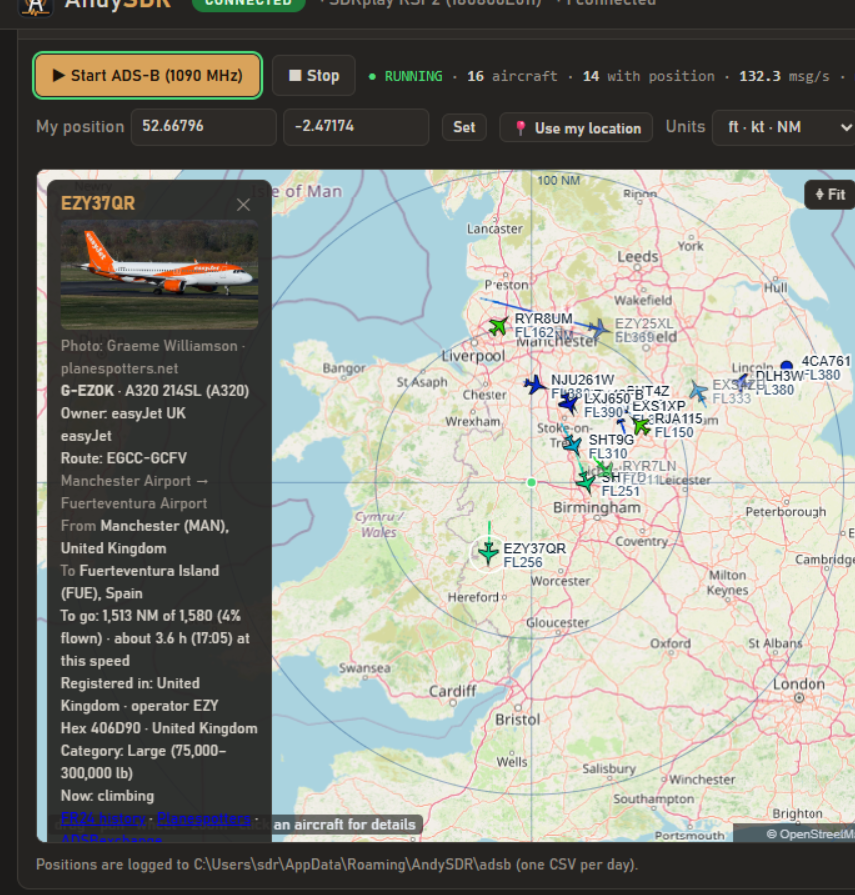

# AndySDR

A desktop SDR scanner for Windows 10/11 with a classic hardware-scanner front panel, a live
spectrum/waterfall, 1000 memory channels, a band search that finds every live transmission,
RadioReference UK CSV import, digital/analogue decoding, weather pictures, and a built-in
network server so any other PC, laptop, tablet or phone in the house can use the radio.

**Latest: 1.20.1** – a new **SKIP ▸ next channel** button (on the display while scanning, above the function keys, and the N key) carries straight on scanning without locking anything out; fix: in a narrower Modern-style window the header no longer pushes the status cards, Style menu and HELP out of view. **1.20.0** – new built-in decoders: **ACARS** aircraft text messages (AIRCRAFT TEXT tab, AM 131.525 / 131.725 / 131.825 MHz) and **radiosondes** – Vaisala RS41 weather balloons (SONDES tab, 400.15–406 MHz: position, height, speed, serial, distance from you); a new adjustable **spectrum / waterfall size** (drag the bar between them, or the Waterfall menu); a new modern app icon; the **SHORTWAVE (EiBi)** tab has been removed; **VDL2** – the digital aircraft data link on 136 MHz (UK: 136.975 MHz busiest) is read too, and the ACARS messages inside it join the AIRCRAFT TEXT list marked VDL2; **TETRAPOL** control-channel signalling (the French-designed police system – not used in the UK) is recognised and decoded automatically too. **1.19.3** – the satellite section now explains that NOAA 15 / 18 / 19 (137 MHz APT) were retired in 2025 and which weather satellites can still be received; new **Metop-B and Metop-C AHRPT** (1701.3 MHz, dish + L-band LNA, 6 or 10 MS/s) in satellite auto-capture, plus a METOP decoder key (untested on a live signal). **1.19.2** – the phone remote no longer offers the Windows installer: it just says updates are installed on the PC. **1.19.1** – fix: in the Modern style the controls card and the spectrum no longer slide over the memory tables when you scroll (they now fill one screen-high work area with the tables below). **1.19.0** – new **Modern** look (dark and light, now the default): roomy flat layout with a scrolling controls card beside a big spectrum and waterfall, bigger dials and buttons, and cool blue waterfall colours (the older styles are still in the Style list); **USB GPS unit** support – tick *Use a USB GPS unit* in the satellite section and AndySDR finds the unit, fills in My position (satellite passes and ADS-B) and re-checks once a day (or hourly / all the time); the theme names are now plain *Soft – dark / Soft – light*; CSV import fills only the chosen bank (never touching used banks) and shows the database file name, its date and the import time. **1.18.5** – sound no longer drops out silently: the screen re-requests audio after a lost connection and wakes a suspended audio engine. **1.18.4** – narrower receive widths: 0.5, 1, 2 and 3 kHz in the WIDTH list for NFM, FM, AM, USB, LSB and DIG. **1.18.3** – the Bias-T power check now refuses to run while Hardware AGC is on (AGC hides the change an LNA makes). **1.18.2** – fixes AndySDR not finding the receiver after an update or a double start: a second copy now refuses to start (and a copy whose server cannot start quits and lets go of the receiver) instead of locking the RSP2 away from the working copy; the log file is capped at 5 MB (it had grown to 200 MB). **1.18.1** – the Bias-T panel no longer says "Powered and working" unless the power check has shown a real change. **1.18.0** – **scheduler**: overlapping captures are flagged (⚠ and a list above the table) and each capture has a **Priority** (High / Normal / Low); a higher one takes over the radio and the interrupted one carries on afterwards, satellite passes count as High; Meteor LRPT pictures from northbound passes are turned **north-up**; **bias-T** is remembered between starts, warns when it is on but the RSP2 input is not Antenna B, and a new **Bias-T panel** in the Receiver tab shows its state, the noise floor and overloads with an on/off **power check**; the chosen **antenna** now stays selected in the dropdown; the ADS-B aircraft card scrolls (no clipped details), the map is taller and the aircraft list re-sorts every 3 s so rows are easier to click. **1.17.1** – the band plan now lists every standard **FT8 and FT4 dial frequency** (160 m to 2 m, including 6 m DX 50.323, the alternative FT4 channels and the second "overflow" FT8 channels); tuning one selects USB and starts the FT8 decoder. **1.17.0** – new **MORSE** key (DECODE row) opens a **Morse code decoder box**: it switches to CW, finds the tone and the sending speed by itself and prints the text on a ticker tape (with a full transcript underneath), plus a list of the most popular Morse frequencies (QRP spots, IARU beacons, 6 m / 4 m / 2 m / 70 cm calling frequencies, aviation NDB beacons) you can click to tune; **faster auto-identify** (a signal is recognised about a second after it starts, re-checked every 0.4 s, and the audio heard while it was being identified is handed to the decoder so the start of a call is no longer lost); **the coded data noise is muted** while DMR / P25 / TETRA / pager decoding runs, so you hear only the decoder's voice (tick box *Mute coded noise while decoding* in the DECODERS tab); DSD-FME in Auto now **tries each frame type in turn** (DMR / P25, then NXDN 12.5 kHz, NXDN 6.25 kHz, legacy auto) if it has not locked on within 3.5 s, replaying the last 5 s of audio each time, so NXDN and P25 calls are no longer missed; the window now **fills wide and ultra-wide monitors**. **1.16.0** – the classic layout is back (the Control room layout was withdrawn; the blue and soft colour themes stay); pinch / Ctrl+scroll now zooms the spectrum, never the browser window; new **10 MS/s** full-bandwidth mode for the RSP2 Pro (choose it under Sample rate). **1.15.1** – steady waterfall scrolling. **1.15.0** – new **Control room** layout (Layout drop-down in the top bar: Auto / Control room / Classic): radio on the left, big spectrum in the middle and seven docked panels around it – memory, decoder list, pictures, scheduler, recordings with instant replay, live activity and pager messages – each with a drop-down to show any other tab and a ⤢ button for full size; four new colour themes in the Style drop-down: **Blue dark, Blue light, Soft dark and Soft light** (the soft ones are easy on the eyes). **1.14.0** – DAB radio and Freeview TV removed; **spectrum zoom** (pinch / stretch, Ctrl+scroll or −/+/Fit buttons; scroll or drag to move the view) with a smoother waterfall; automatic bandwidth now also knows broadcast stations and CW; the **band plan only lists what your receiver can tune** (RSP2 Pro: 1 kHz–2 GHz); picture decoders save the **picture only** (blank pictures are discarded, the large Meteor IQ file is deleted once the pictures exist) and sound recordings save **sound only**; new **🗑 Delete** buttons on pictures and recordings; receive quality: AM loudness is now steady whatever the signal strength, an impulse **noise blanker** (AM / SSB / CW), smoother AGC and a 0.25 s squelch hang so word endings are not chopped; **⏪ Instant replay** – AndySDR remembers the last two minutes of what you heard, so you can replay the last 15 s / 30 s / 60 s / 2 min (REPLAY button under the display) or keep it as a recording. **1.13.1** – small fix: the DAB tab no longer shows "[object Object]" while the ensemble name is still being decoded. **1.13.0** – the **⬇ Download** buttons now save straight into your Downloads folder on the radio PC (remote PCs and phones use their browser's normal download);  **DAB station finder**: press *Scan for stations* once and AndySDR visits every Band III block, remembers each multiplex and station name, then you type a name (e.g. Kisstory) and press *Play* – it tunes the right block itself. New **SHORTWAVE (EiBi)** tab: download the EiBi shortwave schedule (or import the file), search by station / language / frequency, show only what is **on air now**, then *Tune*, store in memory (★) or add an automatic tune-in (⏰) that uses the scheduler. **1.12.0** – every picture in **WEATHER IMAGES** now shows the satellite or station name, frequency and time it was captured, with a **⬇ Download** button (the enlarged view has one too); a new **RECORDINGS** tab lists sound recordings with **Play** and **⬇ Download**. The IMAGES / RECORDINGS keys now open these tabs instead of Windows Explorer, so they work from remote PCs, tablets and phones. **1.11.1** – TETRA now fixes mirrored (I/Q-swapped) signals by itself and shows a short readable summary (network, cell frequencies, encryption on/off, neighbour cells, call set-ups, channel allocations, text messages). **1.11.0** – TETRA decoder (own demodulator + osmo-tetra) and Doppler-tracked satellite recording. – MeshCore with just an SDR - a receive-only LoRa decoder in the MESHCORE tab lists repeaters, room servers, companions and sensors from their adverts (with positions) and reads public / #hashtag channel messages, plus a live packet log. No LoRa board needed (experimental; nothing is transmitted). **1.8.0** – new FILES buttons under the display open the weather-images folder and the sound-recordings folder; satellite auto-capture now has Mon–Sun day boxes (no times needed - captures start only when the satellite is over you); ADS-B aircraft panel shows far more: origin/destination cities, distance to go and rough arrival time, plain-English category, flight phase, squawk meaning, military flag, owner country and session peaks. **1.7.0** – a **WIDTH** drop-down (receive-filter bandwidth) under the mode buttons with the usual widths for each mode and a ★ suggestion worked out from the running decoder, Auto ID and the band plan. **1.6.1** – update check works on PCs whose certificate store can't verify GitHub, and errors say why. **1.6.0** – a new **SDR++ style** theme; **satellite auto-capture** (ISS SSTV, Meteor-M N2-3 / N2-4 LRPT and GOES-East/West HRIT, scheduled from live pass predictions); **aircraft registry lookup** and a bright map in the ADS-B tab; an **FT8 / FT4** decoder that starts itself on band-plan channels; and an experimental **DAB radio** tab with a station list and player. (1.5.1: fuller front panel (status strip, indicator lights, one-click mode / band / decoder buttons), **SKIP** buttons to temporarily ignore a scanned channel, and a bigger band plan with a new *Extra large* size. 1.5.0 made AndySDR update itself from GitHub; 1.4.0 added the ADS-B tab, 1.3.1 the PAGER MESSAGES tab, 1.3.0 MeshCore messaging.)


## Screenshots

**ADS-B aircraft map** – live aircraft on a map with distance rings, flight levels, and a detail card showing the aircraft photo, type, owner, route, distance to go and more.



## What's in it

| Area | Details |
|---|---|
| Front panel | **Status strip** across the top of the radio (local + UTC clocks, receiver, span, filter, scan state, decoder, connected screens), **RX / SCAN / DEC / REC / LINK lights**, and **quick buttons under the display**: one-click MODE, UK BAND jumps (air, marine, PMR, 2 m, 70 cm, CB, FM, pager, weather sats), DECODE (DMR, P25, NXDN, dPMR, M17, TETRA, pager, APRS, WEFAX, SSTV, LRPT, ADS-B, Auto ID), **SKIP / LOCK OUT / UNSKIP**, AGC, MUTE, MONITOR and STEP −/+. Four switchable styles (**SDR++ style** = flat dark panels, controls in a sidebar, big spectrum + waterfall): **PRO-2045 style** (amber 7-segment LCD), **UBCD260DN style** (black base/mobile, white-blue dot-matrix), **TRX-2 style** (rugged gunmetal, grey-green dot-matrix). VOLUME, SQUELCH and RF GAIN knobs (drag, mouse wheel, arrow keys, double-click to reset), full keypad, SCAN / MAN / SRCH / PGM / L/O / PRI / MODE / STEP / BANK / DLY / REC / DEC keys, S-meter with squelch marker, status flags. |
| Receivers | **SDRplay RSP1, RSP1A, RSP1B, RSP2, RSP2pro, RSPduo, RSPdx, RSPdx-R2 through SDRplay's own API** (antenna A/B/Hi-Z, bias-T, FM/DAB notch, LNA+IF gain, AGC). RTL-SDR (Nooelec etc.), Airspy, HackRF, LimeSDR, PlutoSDR and others via SoapySDR. rtl_tcp network dongles. Built-in **Simulator** for practice. |
| Modes | NFM, FM, AM, WFM (50 µs UK de-emphasis), USB, LSB, CW, DIG (12.5 kHz digital), DIG25 (25 kHz digital). |
| Bandwidth | **WIDTH** drop-down under the mode buttons: the usual receive-filter widths for the current mode (e.g. NFM 6–20 kHz, AM 4–20 kHz, SSB 1.8–4.5 kHz, CW 100 Hz–1.2 kHz). **Auto** follows the **★ suggestion**, worked out from the running decoder (DMR/P25 12.5 kHz, TETRA 25 kHz, M17 9 kHz…), what Auto ID recognised or measured, and the channel spacing of the band you are tuned to (the reason is shown under the box). A width you pick is remembered per mode; the red band on the spectrum and the FILTER read-out follow it. |
| Scanning | Memory scan across selected banks with lockouts, resume delay, priority channel. A **SKIP ▸ next channel** button (on the display while scanning, above the function keys, and the N key) leaves what the scanner is stopped on and carries straight on – nothing is locked out. **SKIP 10 MIN / 1 HOUR / TODAY** temporarily ignores the channel the scanner is stopped on (or a frequency found by search) – it is scanned again when the time is up or you press **UNSKIP**; keyboard **I** = skip 10 min. **LOCK OUT** (the L/O key) is the permanent version. Uses the spectrum to skip silent channels instantly. |
| Search | Sweeps any range (UK quick ranges included) and logs every live signal with hit count and strength; *stop on signal* or *sweep & log only*. Search lockouts. |
| UK band plan | Every UK allocation, amateur sub-band and key frequency from 9 kHz to 6.5 GHz (Ofcom UK FAT + RSGB band plans), drawn in colour across the top of the spectrum. Size selectable: Off / Small / Medium / Large / Extra large (Large and Extra large use big, easy-to-read text). A full-range **band map** shows the whole spectrum with a red **VFO needle** and the part the waterfall is showing; the **VFO bar** names the band you are in and offers the usual mode/step. **UK BAND PLAN** tab: drill down **Plan › Band › Section** (e.g. Marine › Marine VHF › Ch 16), Tune or Search any section, add a band's key frequencies to a memory bank in one go, and show/hide each plan on the spectrum. |
| Auto ID | **Automatic signal identification**: AndySDR analyses whatever you're tuned to and works out what it is – DMR (spots the 30 ms TDMA bursts), P25, NXDN, dPMR, POCSAG/FLEX pagers, APRS, DTMF, SSTV, WEFAX, TETRA or analogue voice (with CTCSS tone) – then switches mode and starts the right decoder by itself. SSTV pictures are caught from their header. A decoder you choose yourself always wins. |
| Scheduler | Timed captures for **WEFAX charts, SSTV (ISS events), Meteor-M passes** or plain recordings: pick a station, start time, length, days of the week or a single date. AndySDR tunes, decodes, then puts the radio back how it was. Quick picks for Northwood WEFAX, ISS/2 m/HF SSTV and Meteor-M. |
| Satellites | **SCHEDULER › Satellite auto-capture**: tick ISS SSTV (145.800 MHz), Meteor-M N2-3 / N2-4 (137.900 / 137.100 MHz LRPT) or GOES-19 / GOES-18 (1694.1 MHz HRIT) and AndySDR predicts every pass over your position (orbit data from CelesTrak), tunes in at acquisition of signal, starts the decoder and stops at loss of signal. Minimum-elevation setting, ISS event-date window, honest *below your horizon* notice for geostationary satellites. A capture you add by hand always wins. |
| FT8 / FT4 | **FT8 / FT4** tab: USB decode in 15 s (FT4: 7.5 s) UTC slots with ft8_lib. Starts by itself when you tune or scan onto an FT8/FT4 dial frequency from the band plan and something is on the air. |
| Memory | 10 banks × 100 channels. RadioReference CSV / copied-table import (UK or any country), talkgroup lists, export to CSV. |
| Decoders | DMR, P25 Phase 1/2, NXDN, dPMR, YSF, M17 (via DSD-FME) · POCSAG & FLEX pagers, APRS, DTMF, ZVEI, EAS (via multimon-ng) · **ADS-B aircraft (1090 MHz), FT8/FT4, WEFAX weather charts and SSTV pictures (Martin, Scottie, Robot, PD modes) built in** · Meteor-M LRPT and GOES HRIT satellite pictures (via SatDump) · DAB/DAB+ (via welle-cli) · **TETRA** (own π/4-DQPSK demodulator + osmo-tetra `tetra-rx`: network MCC/MNC, cell and call signalling, text messages; encrypted networks such as Airwave show signalling only) · **TETRAPOL** (own GMSK demodulator + Tetrapol-kit `tetrapol_dump`: cell, call and message signalling only – there is no free speech decoder; not used in the UK). |
| ADS-B aircraft | **ADS-B** tab: press **▶ Start ADS-B** and AndySDR tunes to 1090 MHz and decodes Mode S / ADS-B itself (any receiver running at 2 MS/s or more – RSP2pro, RTL-SDR, Airspy, HackRF…). Live **aircraft table** (callsign, hex, airline, country, altitude, speed, heading, climb, squawk, distance, messages, last seen – click a heading to sort, filter by text) and a **map** with plane icons pointing the way they fly, height colours, trails, range rings and click-for-details; bright street map by default (or dark / offline styles). **Aircraft info**: registration, type, owner, route and a photo are looked up online (hexdb.io and planespotters.net – only the hex code is sent; switch it off with *Look up registration…*) and cached on disk. Emergency squawks (7500/7600/7700) flash red. Enter your position for distance/bearing and faster fixes. Daily CSV log, CSV export, and an optional feed to other programs (SBS port 30003, raw port 30002, dump1090-style `aircraft.json`). Works from remote PCs and phones too. |
| MeshCore (SDR only) | **MESHCORE tab › 📡 Listen with just the SDR**: receive-only LoRa decoder, no board. Press *Start listening* (UK/EU: 869.618 MHz, 62.5 kHz, SF8). **Nodes** – every repeater, room server, companion and sensor heard advertising, with name, position (map link), hops, signal and last heard; filter by type, export CSV. **Messages** – Public channel and any #hashtag / keyed channel you add. **Packet log** – everything heard, including encrypted direct messages (counted, not readable) and damaged frames. Experimental: needs a decent 869 MHz antenna, receive only. |
| MeshCore messaging | **MESHCORE** tab: text chat over the MeshCore LoRa mesh through a MeshCore companion board (Heltec V3/V4, RAK4631, T-Deck, T-Beam, Xiao…) on USB, Wi-Fi or Bluetooth. Public and #hashtag channels, private channels, direct messages with delivery ticks, node list with last-heard and hops, adverts, UK/EU preset, unread badges, message history, and **Watch on SDR** to see the packets on the waterfall. Works from remote PCs and phones too. |
| Pager messages | **PAGER MESSAGES** tab lists every POCSAG (512/1200/2400) and FLEX page as a table: time, frequency, protocol, capcode, your name for the capcode, type (text / numeric / tone only) and the message, newest first. Search, filter by protocol or type, highlight capcodes (with a pop-up notice when they are paged), export to CSV. Every page is also logged to a daily CSV file. Repeats within a minute are shown once. A badge on the tab counts new messages. Works the same from remote PCs, tablets and phones. |
| Remote | Every copy of AndySDR is also a server (port 8045). Open `http://<pc-name-or-ip>:8045` in a browser on any device on the network, enter the password, and you get the full radio with audio and waterfall. |
| Updates | **Self-update from GitHub Releases**: checks on start-up and every 12 h (or press *Check for updates now*), shows a pop-up with the release notes – **Download & install / Remind me later / Skip this version** – checks the download against GitHub's SHA-256, asks again before installing, then restarts itself. Works for the installed and the portable copy. |
| Help | **? HELP** explains every control; *Explain mode* lets you click any knob or key for a description. Hover tooltips everywhere. |

## Getting the .exe

**Easiest – let GitHub build it for you (no installs on your PC):**
1. Create a free GitHub account, make a new repository, and upload this whole folder (including the hidden `.github` folder).
2. Open the repository's **Actions** tab – the "Build AndySDR for Windows" job runs automatically (about 10 minutes).
3. Download the **AndySDR-windows** artifact: it contains `AndySDR-windows.zip` (unzip and run `AndySDR.exe`) and `AndySDR-Setup.exe` (installer with Start-menu shortcut and firewall rule).

**Or build on your own PC:**
1. Install [Miniforge](https://github.com/conda-forge/miniforge).
2. Open *Miniforge Prompt*, `cd` into this folder, run `build_windows.bat`.
3. Run `dist\AndySDR\AndySDR.exe`.

**Or run straight from source:** with Python 3.10+ installed: `pip install -r requirements.txt` then `python run_andysdr.py`.

## Updating AndySDR

AndySDR looks for a newer version on this project's GitHub Releases page a few seconds after it starts and then every
12 hours. When there is one, a pop-up shows what is new:

* **Download & install** – downloads the update (progress bar), checks its size and SHA-256 against what GitHub publishes,
  then asks **Install & restart**. AndySDR closes, updates itself and starts again (with `--server` if it was running that way).
* **Remind me later** – the pop-up returns next time AndySDR starts. **Skip this version** – not offered again until a newer one appears.
* **REMOTE & SETTINGS › Updates** has **Check for updates now** (also brings back a skipped version), a switch to turn the automatic
  check off, and *Download new versions in the background, then ask before installing*.

How it installs: a copy installed with `AndySDR-Setup.exe` runs the new installer quietly (Windows may show its usual permission
prompt if AndySDR is in *Program Files*); a portable (unzipped) copy has the new files copied over the old ones; a copy running from Python
source just opens the release page. Your settings, memories and pictures in `%APPDATA%\AndySDR` are never touched. The pop-up also appears
in a remote browser and the buttons work there too, but the update happens on the radio PC (the remote screen reconnects by itself).
Downloads are kept in `%APPDATA%\AndySDR\updates` and only ever come from `github.com/mrandyt/AndySDR/releases`.

**Publishing a new version (for you):** raise `VERSION` in `andysdr/config.py`, commit and push to `main`. GitHub builds the exe and
publishes release `v<VERSION>` with `AndySDR-Setup.exe` and `AndySDR-windows.zip` - existing copies then offer it. Pre-releases and drafts are ignored.

## One-time setup for your receivers

* **SDRplay (RSP2pro etc.)** – install *SDRplay API 3.x for Windows* from sdrplay.com. AndySDR finds `C:\Program Files\SDRplay\API\x64\sdrplay_api.dll` automatically. Close SDRuno/SDR# first – only one program can use the RSP at a time.
* **RTL-SDR / Nooelec** – run [Zadig](https://zadig.akeo.ie), *Options › List all devices*, pick *Bulk-In, Interface (Interface 0)*, install **WinUSB**.
* **Airspy / HackRF** – install the manufacturer's Windows driver.
* **Decoders** – nothing to do: DSD-FME, multimon-ng and SatDump are bundled in the `decoders` folder next to `AndySDR.exe` (the installer also adds the Visual C++ runtime SatDump needs). The DECODERS tab shows a green tick for each one; if any shows a red cross, press **⬇ Download missing decoders** and AndySDR fetches it from GitHub.

## MeshCore messaging

AndySDR's receivers can only listen, so messages are sent and received by a small **MeshCore companion
board** (about £20–40: Heltec V3/V4, RAK WisBlock 4631, LilyGO T-Deck or T-Beam, Seeed Xiao…).

1. Flash it with **Companion** firmware from <https://flasher.meshcore.co.uk> – *USB Serial* if it will be
   plugged into the PC, *Bluetooth* or *Wi-Fi* otherwise (not Repeater or Room Server).
2. In AndySDR open the **MESHCORE** tab, choose *USB (COM port)*, pick the board's port (★ marks likely
   radio boards) and press **Connect**. For Wi-Fi enter `ip:port` (usually port 5000); for Bluetooth press
   **Find boards** (enter the PIN if one is set). AndySDR reconnects automatically next time.
3. If your board is new, press **Use UK preset** (869.618 MHz, 62.5 kHz, SF8, CR8 – what most UK nodes use),
   set a **Node name**, and press **Send advert** so others can see you.

Channels: *Public* is on every board; **+ Join** adds a public `#hashtag` channel (e.g. `#uk`) or a private
channel with a 32-hex-digit key. Contacts appear when nodes advertise – click one for an end-to-end encrypted
direct message (✓ sent, ✓✓ delivered). 869.4–869.65 MHz is licence-exempt in the UK; the board's firmware
keeps to the power and duty-cycle limits.

## Using it from another PC

1. On the radio PC, open the **REMOTE & SETTINGS** tab – it shows the address(es) and password.
2. Allow AndySDR through Windows Firewall when asked (*Private networks*).
3. On the other device, open the address in Chrome/Edge/Firefox/Safari and enter the password. Press **AUDIO ON/OFF** to hear it.

To run the radio PC without a window (e.g. a spare PC in the loft): `AndySDR.exe --server`.
Options: `--port 8045`, `--host 127.0.0.1` (this PC only), `--password NEWPASS`, `--browser`.
Keep AndySDR on your home network – do not port-forward it to the internet.

## RadioReference UK import

On radioreference.com open a county or agency page in the UK database and download its CSV
(premium feature), or select the frequency table on the page, copy it and paste it into a
text file. In AndySDR: **MEMORY › RadioReference UK import**, choose the file and a bank,
press **Import CSV**. Frequency, Alpha Tag, Description, Mode, Tag and Tone columns are recognised;
FMN/FM/AM/DMR/P25/NXDN/TETRA/POCSAG modes are mapped and the right decoder is attached.
`samples/radioreference_uk_example.csv` shows the format.

## ADS-B aircraft tracking

1. You need an antenna that works at 1090 MHz – a 6.9 cm whip (quarter wave) or a proper 1090 MHz collinear/ADS-B
   antenna, as high and clear as you can get it. VHF/airband antennas are poor at 1090 MHz. On an SDRplay RSP use the
   **Antenna A / B** (50 Ω) socket, not Hi-Z. A 1090 MHz filter/LNA close to the antenna helps a lot with long cables.
2. Open the **ADS-B** tab and press **▶ Start ADS-B (1090 MHz)**. AndySDR tunes to 1090 MHz, centres the receiver
   exactly on it (if the receiver was running below 2 MS/s it is switched to 2.4 MS/s) and starts the built-in decoder.
   Turn **RF GAIN** up fairly high; if you see plenty of messages but few aircraft, turn it down a little.
3. Aircraft appear within seconds. Type your **My position** (latitude/longitude in decimal degrees, e.g. `51.5074`, `-0.1278`)
   and press **Set** – you then get range rings, each aircraft's distance and bearing, and positions decode from a single
   message instead of needing a pair.
4. **Stop** (or tuning anywhere else) takes you back to normal scanning.

| Item | What it shows |
|---|---|
| Table | Callsign · hex (ICAO) address · airline (from the callsign) or country (from the address) · altitude · speed · heading · climb rate · squawk · distance from you · messages · time since last heard. Click a column title to sort, click a row to highlight it; faded = not heard for 30 s; rows disappear after 2 minutes. |
| Map | Plane icons point along their track and are coloured by height (orange low → green → blue high), with trails behind. Drag = pan, wheel / + − = zoom, **⌖ Fit** = show everything, click a plane for its details. The **Map** box picks a bright street map (default), a dark street map, or plain bright / dark grids that work offline. |
| Alerts | Squawk 7500 (hijack), 7600 (radio failure) and 7700 (emergency) flash red on the map and table and pop up a warning. |
| Units | Aviation (ft · kt · NM) or metric (m · km/h · km) – remembered per computer. |
| Log / export | `%APPDATA%\AndySDR\adsb\adsb_YYYY-MM-DD.csv` gets one line per aircraft every 30 s; **Export CSV** saves the current list. |
| Sharing | In **REMOTE & SETTINGS** tick *Send the ADS-B feed over the network* to let other programs use AndySDR as their receiver: **SBS/BaseStation on TCP 30003**, **raw AVR on TCP 30002**. `http://<pc>:8045/api/aircraft.json?token=<password>` is a dump1090-style list. |

How it works: the radio thread passes the raw samples to a decoder thread that builds a 2 MS/s amplitude stream, finds Mode S
preambles (at two half-sample phases so no frame falls between samples), checks the 24-bit CRC (single-bit errors in
ADS-B frames from known aircraft are repaired) and decodes identification, airborne/surface position (CPR), altitude,
velocity, squawk and emergency state. Typical decode rate in the self-test is 97–98 % of simulated frames at any sample rate from 2 to 10 MS/s.
With the **Simulator** receiver you get ten practice aircraft around 51.5 N, 1.0 W (or around your own position).
Self-test: `python tests/test_adsb.py` (decoder) and `python tests/test_radio_adsb.py` (whole engine on the simulator).

## Aircraft text (ACARS, VDL2) and weather balloons

All three decoders are built in (no extra program to download).

* **ACARS** – the airlines' text messages with aircraft. Press the **ACARS** decoder key (or ▶ Start ACARS in the AIRCRAFT TEXT tab) on an AM channel around 131 MHz; in the UK 131.525, 131.725 and 131.825 MHz are the busiest. Each block shows registration, flight, label and message. Blocks are checked with the CRC and per-character parity; one or two damaged characters are repaired. A CSV per day is saved in `%APPDATA%\AndySDR\acars`.
* **VDL2** – the newer digital version of ACARS on 136.xxx MHz (D8PSK, 10.5 kbaud, 25 kHz channel). Press the **VDL2** key (or ▶ Start VDL2, or one of the 136 MHz buttons, in the AIRCRAFT TEXT tab); AndySDR switches to the 25 kHz digital mode and reads the signal itself. UK channels: 136.975 MHz (busiest), 136.725, 136.775, 136.825, 136.875 and 136.925 MHz. Frames are checked with the Reed-Solomon error correction and the frame checksum; the ACARS messages inside are listed in AIRCRAFT TEXT with a small VDL2 tag (the aircraft's address is in the tooltip and the CSV). Other VDL2 traffic (logon and routing frames) is counted but not shown. It needs a clean, fairly strong signal – a weak one gives fewer messages, not wrong ones.
* **Radiosondes** – press **SONDE** (or ▶ Start sonde decoder in the SONDES tab) on a balloon signal between 400.15 and 406 MHz; AndySDR switches to narrow FM, 16 kHz wide. Vaisala **RS41** sondes (the type the Met Office launches) are read: serial, GPS position, height, speed, climb, heading and satellites, with distance and bearing from you when *My position* is set. A CSV per day is saved in `%APPDATA%\AndySDR\sondes`. Other makes (DFM, M10, iMet) are not read yet.

ACARS and the RS41 were checked against real recordings (from the open-source acarsdec and rs1729 projects) as well as generated test signals. **VDL2 has only been tested against a transmitter written from the same protocol description** (no real VDL2 recording was available), so treat it as unproven until you have seen it read a real aircraft; none of the three has been tried on your own receiver yet.

## TETRAPOL

TETRAPOL is the French-designed digital radio system of the police and gendarmerie in France and of forces in Spain, Switzerland, the Czech Republic, Slovakia, Hungary and some other countries. **It is not used in the UK**, so you will only find it abroad (or by receiving remotely). Press the **TETRAPOL** key on a 12.5 kHz control channel (DIG mode), or leave Auto ID on: it recognises the 8000 baud GMSK signal and the 20 ms frame-sync pattern, corrects a mirrored spectrum by itself and starts the decoder. The log shows the cell (country code, network, location area), neighbour cells and call signalling. **Signalling only** – there is no free speech decoder, and most networks encrypt.

Status, stated plainly: the demodulator and the automatic identification are tested against generated signals only (no real TETRAPOL recording was available). The decoder program `tetrapol_dump` (Tetrapol-kit, GPL-2.0) is built by the Windows workflow with a build recipe and compatibility shims written without being able to compile it first, so if that build step fails the TETRAPOL key tells you the program is missing; everything else still works.

## Pager messages (POCSAG / FLEX)

1. Tune a pager frequency in **DIG** mode. In the UK most pager traffic is between about 153.0 and 153.5 MHz –
   the **Pagers** quick range in *LIVE ACTIVITY / SEARCH* finds the busy channels for you.
2. Open the **PAGER MESSAGES** tab and press **▶ Start pager decoder** (or leave *Auto-identify* on and AndySDR
   starts it when it recognises a pager signal). multimon-ng decodes POCSAG 512, 1200, 2400 and FLEX at the same time.
3. Each page appears as a new row at the top:

| Column | What it shows |
|---|---|
| ★ | Click to highlight that capcode: its rows are coloured and a notice pops up whenever it is paged. *★ Highlighted only* hides the rest. |
| Time / Frequency | When it was received and the frequency (click the frequency to tune there). |
| Protocol | POCSAG 512 / 1200 / 2400 or FLEX 1600 / 3200 / 6400. |
| Capcode | The pager's address (POCSAG adds the function number, e.g. `123456/3`). Click it to show only that capcode. |
| Name | Your name for the capcode – click **+ name** to set or change it. Names are saved and used in exports. |
| Type | *Alpha* (text), *Numeric* or *Tone* (a beep with no message). |
| Message | The decoded text. FLEX group pages list the other capcodes they went to. |

* **Search** looks in the message, capcode, name and frequency. *Protocol*, *Type* and *Hide tone-only* narrow the list further.
* **Export CSV** downloads the list (with names). **Clear list** empties the screen; log files are kept.
* Every message is also saved to `%APPDATA%\AndySDR\pager\pager_YYYY-MM-DD.csv` (one file per day), and today's
  messages come back when AndySDR restarts.
* The same page heard again within a minute (repeat transmissions, or two POCSAG speeds catching it) is listed once.
* The raw multimon-ng output still appears in the DECODERS tab log.

Remember that in the UK it is an offence to act on, or pass on, the content of pager messages you are not
authorised to receive – see *Legal* below.

## Weather pictures

* **HF WEFAX** (built in): UK Met Office Northwood on 2618.5, 4610, 8040 and 11086.5 kHz. Tune the
  frequency in USB, start the WEFAX decoder – charts appear in **WEATHER IMAGES**. Needs HF reception
  (the RSP2pro covers it; RTL-SDR needs direct-sampling mode or an upconverter).
* **Meteor-M LRPT**: Meteor-M N2-3 and N2-4 transmit on 137.9 MHz (sometimes 137.1 MHz), 72k.
  (Meteor-M N2-2's LRPT is no longer working.) Use DIG25 mode, start the LRPT decoder when the
  satellite rises and stop it when it sets; SatDump then makes the pictures. A V-dipole or QFH antenna helps a lot.

* **Automatic passes**: use **SCHEDULER › Satellite auto-capture** instead of watching the clock – see *Satellites* above. Enter your position once (it is shared with the ADS-B position if you set that first).
* **GOES HRIT** (1694.1 MHz, GOES-19 East at 75.2°W and GOES-18 West at 137°W): needs a 1 m-class dish, an L-band LNA and a clear view of the satellite. From the UK GOES-East sits right on the horizon, so AndySDR reports it as below your horizon – there is nothing to receive. Decoded with SatDump through a local rtl_tcp link to your receiver. (LRIT on 1691 MHz was replaced by HRIT on the GOES-R satellites.)
* **SSTV** (built in): ISS events on 145.800 MHz NFM, 2 m 144.500 MHz NFM, 20 m 14.230 MHz USB, 40 m 7.165 LSB.
  Leave Auto ID on, or start the SSTV decoder – pictures appear in **Weather images**. Use the **Scheduler** to catch them while you're out.

## Where things are stored

`%APPDATA%\AndySDR\` – `aircraft_cache.json` (registry lookups), `tle_cache.json` (satellite orbit data), `settings.json` (also holds capcode names, highlights and your ADS-B position), `memory.json`, `meshcore_messages.jsonl`, `images\`, `recordings\`, `pager\` (daily pager message logs), `adsb\` (daily aircraft position logs), `logs\andysdr.log`.

## Legal (UK)

The Wireless Telegraphy Act 2006 allows listening to broadcast, amateur and CB transmissions; it is an
offence to listen to other transmissions you are not authorised to receive or to disclose their content.
AndySDR cannot decode encrypted signals (e.g. Airwave TETRA: you will see the network and signalling, not the speech). Check the law where you live.

## Project layout

```
andysdr/main.py        start-up, desktop window, command-line options
andysdr/engine.py      radio thread: tuning, scanner, search, priority, recording
andysdr/dsp.py         filters, demodulators, squelch, spectrum
andysdr/devices.py     SoapySDR, rtl_tcp, simulator
andysdr/sdrplay.py     native SDRplay API 3.x backend
andysdr/decoders.py    DSD-FME / multimon-ng / SatDump / TETRA plumbing
andysdr/tetrademod.py  TETRA pi/4-DQPSK demodulator (feeds osmo-tetra tetra-rx)
decoders_src/tetra/    build recipe + Windows shims for tetra-rx (built in the GitHub workflow)
andysdr/tetrapol.py    TETRAPOL GMSK demodulator, frame-sync/polarity detection, auto-ID probe (feeds Tetrapol-kit tetrapol_dump)
decoders_src/tetrapol/ build recipe + Windows shims for tetrapol_dump (built in the GitHub workflow)
andysdr/wefax.py       built-in weather fax decoder
andysdr/pager.py       POCSAG/FLEX message parser, capcode names, daily pager logs
andysdr/adsb.py        ADS-B / Mode S demodulator, aircraft tracker, SBS + raw feeds
andysdr/adsb_sim.py    ADS-B message encoder + simulated air traffic (Simulator receiver, tests)
tests/                 self-tests: adsb, aircraftinfo, satpass, satsched, ft8, updater, lockout (python tests/test_<name>.py)
andysdr/memory.py      memory banks + RadioReference import
andysdr/meshlink.py    MeshCore messaging through a companion board (USB / Wi-Fi / Bluetooth)
andysdr/server.py      network server (HTTP + WebSocket, password protected)
andysdr/aircraftinfo.py aircraft registry / photo lookup with disk cache
andysdr/satpass.py     satellite pass prediction (SGP4) and auto-capture planner
andysdr/iqbridge.py    local rtl_tcp-compatible IQ server (SatDump uses your receiver through it)
andysdr/ft8.py         FT8 / FT4 slot handling around ft8_lib's decode_ft8
andysdr/updater.py     self-update: GitHub release check, download + SHA-256 check, install, restart
andysdr/web/           the front panel (HTML/CSS/JS) and logo
AndySDR.spec           PyInstaller recipe        build_windows.bat   local build
installer.iss          Inno Setup installer      .github/workflows   cloud build
```
