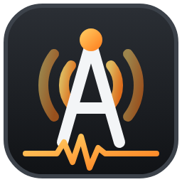

# AndySDR

A desktop SDR scanner for Windows 10/11 with a classic hardware-scanner front panel, a live
spectrum/waterfall, 1000 memory channels, a band search that finds every live transmission,
RadioReference UK CSV import, digital/analogue decoding, weather pictures, and a built-in
network server so any other PC, laptop, tablet or phone in the house can use the radio.



## What's in it

| Area | Details |
|---|---|
| Front panel | Three switchable styles: **PRO-2045 style** (amber 7-segment LCD), **UBCD260DN style** (black base/mobile, white-blue dot-matrix), **TRX-2 style** (rugged gunmetal, grey-green dot-matrix). VOLUME, SQUELCH and RF GAIN knobs (drag, mouse wheel, arrow keys, double-click to reset), full keypad, SCAN / MAN / SRCH / PGM / L/O / PRI / MODE / STEP / BANK / DLY / REC / DEC keys, S-meter with squelch marker, status flags. |
| Receivers | **SDRplay RSP1, RSP1A, RSP1B, RSP2, RSP2pro, RSPduo, RSPdx, RSPdx-R2 through SDRplay's own API** (antenna A/B/Hi-Z, bias-T, FM/DAB notch, LNA+IF gain, AGC). RTL-SDR (Nooelec etc.), Airspy, HackRF, LimeSDR, PlutoSDR and others via SoapySDR. rtl_tcp network dongles. Built-in **Simulator** for practice. |
| Modes | NFM, FM, AM, WFM (50 µs UK de-emphasis), USB, LSB, CW, DIG (12.5 kHz digital), DIG25 (25 kHz digital). |
| Scanning | Memory scan across selected banks with lockouts, resume delay, priority channel. Uses the spectrum to skip silent channels instantly. |
| Search | Sweeps any range (UK quick ranges included) and logs every live signal with hit count and strength; *stop on signal* or *sweep & log only*. Search lockouts. |
| Memory | 10 banks × 100 channels. RadioReference CSV / copied-table import (UK or any country), talkgroup lists, export to CSV. |
| Decoders | DMR, P25 Phase 1/2, NXDN, dPMR, YSF, M17 (via DSD-FME) · POCSAG & FLEX pagers, APRS, DTMF, ZVEI, EAS (via multimon-ng) · **WEFAX weather charts built in** · Meteor-M LRPT satellite pictures (via SatDump) · TETRA baseband out over UDP. |
| Remote | Every copy of AndySDR is also a server (port 8045). Open `http://<pc-name-or-ip>:8045` in a browser on any device on the network, enter the password, and you get the full radio with audio and waterfall. |
| Help | **? HELP** explains every control; *Explain mode* lets you click any knob or key for a description. Hover tooltips everywhere. |

## Getting the .exe

**Easiest – let GitHub build it for you (no installs on your PC):**
1. Create a free GitHub account, make a new repository, and upload this whole folder (including the hidden `.github` folder).
2. Open the repository's **Actions** tab – the "Build AndySDR for Windows" job runs automatically (about 10 minutes).
3. Download the **AndySDR-windows** artifact: it contains `AndySDR-windows.zip` (unzip and run `AndySDR.exe`) and `AndySDR-Setup.exe` (installer with Start-menu shortcut and firewall rule).

**Or build on your own PC:**
1. Install [Miniforge](https://github.com/conda-forge/miniforge).
2. Open *Miniforge Prompt*, `cd` into this folder, run `build_windows.bat`.
3. Run `dist\AndySDR\AndySDR.exe`.

**Or run straight from source:** with Python 3.10+ installed: `pip install -r requirements.txt` then `python run_andysdr.py`.

## One-time setup for your receivers

* **SDRplay (RSP2pro etc.)** – install *SDRplay API 3.x for Windows* from sdrplay.com. AndySDR finds `C:\Program Files\SDRplay\API\x64\sdrplay_api.dll` automatically. Close SDRuno/SDR# first – only one program can use the RSP at a time.
* **RTL-SDR / Nooelec** – run [Zadig](https://zadig.akeo.ie), *Options › List all devices*, pick *Bulk-In, Interface (Interface 0)*, install **WinUSB**.
* **Airspy / HackRF** – install the manufacturer's Windows driver.
* **Decoders** – unzip DSD-FME, multimon-ng and SatDump into the `decoders` folder next to `AndySDR.exe` (see `decoders/README.txt`). The DECODERS tab shows a green tick for each one found.

## Using it from another PC

1. On the radio PC, open the **REMOTE & SETTINGS** tab – it shows the address(es) and password.
2. Allow AndySDR through Windows Firewall when asked (*Private networks*).
3. On the other device, open the address in Chrome/Edge/Firefox/Safari and enter the password. Press **AUDIO ON/OFF** to hear it.

To run the radio PC without a window (e.g. a spare PC in the loft): `AndySDR.exe --server`.
Options: `--port 8045`, `--host 127.0.0.1` (this PC only), `--password NEWPASS`, `--browser`.
Keep AndySDR on your home network – do not port-forward it to the internet.

## RadioReference UK import

On radioreference.com open a county or agency page in the UK database and download its CSV
(premium feature), or select the frequency table on the page, copy it and paste it into a
text file. In AndySDR: **MEMORY › RadioReference UK import**, choose the file and a bank,
press **Import CSV**. Frequency, Alpha Tag, Description, Mode, Tag and Tone columns are recognised;
FMN/FM/AM/DMR/P25/NXDN/TETRA/POCSAG modes are mapped and the right decoder is attached.
`samples/radioreference_uk_example.csv` shows the format.

## Weather pictures

* **HF WEFAX** (built in): UK Met Office Northwood on 2618.5, 4610, 8040 and 11086.5 kHz. Tune the
  frequency in USB, start the WEFAX decoder – charts appear in **WEATHER IMAGES**. Needs HF reception
  (the RSP2pro covers it; RTL-SDR needs direct-sampling mode or an upconverter).
* **Meteor-M LRPT**: Meteor-M N2-3 and N2-4 transmit on 137.9 MHz (sometimes 137.1 MHz), 72k.
  (Meteor-M N2-2's LRPT is no longer working.) Use DIG25 mode, start the LRPT decoder when the
  satellite rises and stop it when it sets; SatDump then makes the pictures. A V-dipole or QFH antenna helps a lot.
* NOAA APT satellites (137.1–137.9 MHz analogue) were retired by NOAA in 2025, so there is no APT decoder.

## Where things are stored

`%APPDATA%\AndySDR\` – `settings.json`, `memory.json`, `images\`, `recordings\`, `logs\andysdr.log`.

## Legal (UK)

The Wireless Telegraphy Act 2006 allows listening to broadcast, amateur and CB transmissions; it is an
offence to listen to other transmissions you are not authorised to receive or to disclose their content.
AndySDR cannot decode encrypted signals (e.g. Airwave TETRA). Check the law where you live.

## Project layout

```
andysdr/main.py        start-up, desktop window, command-line options
andysdr/engine.py      radio thread: tuning, scanner, search, priority, recording
andysdr/dsp.py         filters, demodulators, squelch, spectrum
andysdr/devices.py     SoapySDR, rtl_tcp, simulator
andysdr/sdrplay.py     native SDRplay API 3.x backend
andysdr/decoders.py    DSD-FME / multimon-ng / SatDump / TETRA plumbing
andysdr/wefax.py       built-in weather fax decoder
andysdr/memory.py      memory banks + RadioReference import
andysdr/server.py      network server (HTTP + WebSocket, password protected)
andysdr/web/           the front panel (HTML/CSS/JS) and logo
AndySDR.spec           PyInstaller recipe        build_windows.bat   local build
installer.iss          Inno Setup installer      .github/workflows   cloud build
```
